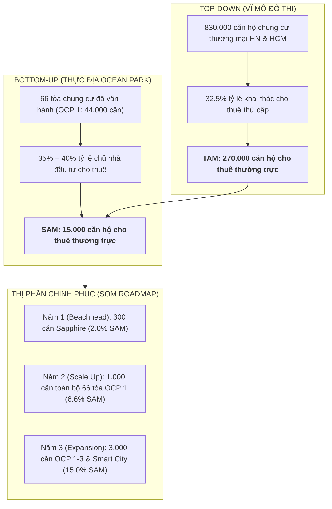
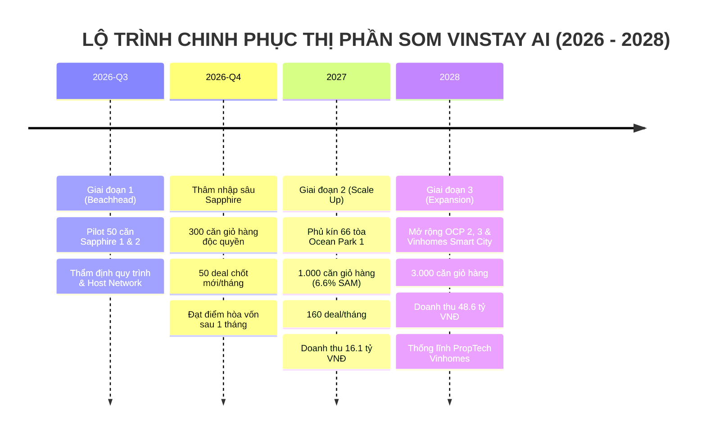
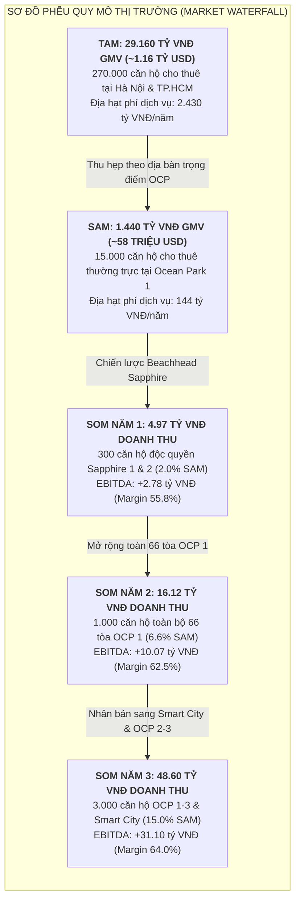
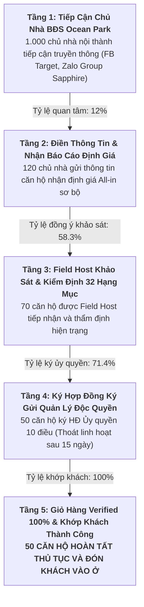
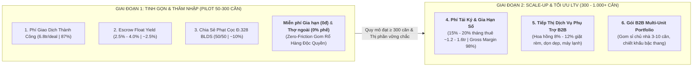
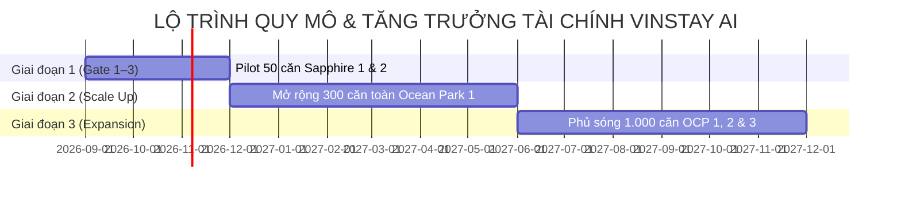

# VINSTAY AI — MÔ HÌNH TÀI CHÍNH, ĐỊNH PHÍ VẬN HÀNH & CƠ CẤU NGUỒN THU
*(FINANCIAL MODEL, UNIT ECONOMICS & REVENUE STRUCTURE)*

> **Chương trình:** AI20K Build Phase — Cohort 4 (Vingroup x VinUniversity)  
> **Dự án:** VinStay AI — Hệ điều hành Cho thuê & Vận hành Căn hộ Tinh gọn (Asset-Light)  
> **Địa bàn triển khai:** Đại đô thị Vinhomes Ocean Park (Gia Lâm, Hà Nội)  
> **Phiên bản:** v2.0 — Chuẩn hóa thẩm định Gate 3 & Demo Day, Đồng bộ Cọc v2 (Điều 328 BLDS), Fast-Deposit Close, Smart Move-in & Bộ Pháp lý 9 Văn bản  
> **Mốc cập nhật:** 16/10/2026  
> **Tác giả / Phụ trách:** Nguyễn Khánh Duy (Team P-010)

---

## MỤC LỤC
1. [TỔNG QUAN CHIẾN LƯỢC TÀI CHÍNH & NGUYÊN TẮC ASSET-LIGHT](#1-tổng-quan-chiến-lược-tài-chính--nguyên-tắc-asset-light)
2. [QUY MÔ THỊ TRƯỜNG & ĐỊA HẠT DOANH THU TIỀM NĂNG (TAM – SAM – SOM)](#2-quy-mô-thị-trường--địa-hạt-doanh-thu-tiềm-năng-tam--sam--som)
   - [2.1. Phương Pháp Luận Tính Toán Hai Chiều & Nguồn Dữ Liệu Kiểm Chứng (Methodology)](#21-phương-pháp-luận-tính-toán-hai-chiều--nguồn-dữ-liệu-kiểm-chứng-methodology)
   - [2.2. TAM (Total Addressable Market - Thị Trường Cho Thuê Căn Hộ Chung Cư Thương Mại)](#22-tam-total-addressable-market---thị-trường-cho-thuê-căn-hộ-chung-cư-thương-mại)
   - [2.3. SAM (Serviceable Available Market - Hệ Sinh Thái Vinhomes Ocean Park)](#23-sam-serviceable-available-market---hệ-sinh-thái-vinhomes-ocean-park)
   - [2.4. SOM (Serviceable Obtainable Market - Thị Phần Mục Tiêu & Lộ Trình 3 Giai Đoạn)](#24-som-serviceable-obtainable-market---thị-phần-mục-tiêu--lộ-trình-3-giai-đoạn)
   - [2.5. Ma Trận Phân Tích Cạnh Tranh & Rào Cản Phòng Thủ Thị Phần (Competitive Moats)](#25-ma-trận-phân-tích-cạnh-tranh--rào-cản-phòng-thủ-thị-phần-competitive-moats)
   - [2.6. Bảng Tổng Hợp Đối Chiếu 3 Cấp Độ Thị Trường & Sơ Đồ Phễu](#26-bảng-tổng-hợp-đối-chiếu-3-cấp-độ-thị-trường--sơ-đồ-phễu-thị-trường)
3. [CHI TIẾT 5 NHÓM CHI PHÍ VẬN HÀNH & ĐẦU TƯ (COST STRUCTURE)](#3-chi-tiết-5-nhóm-chi-phí-vận-hành--đầu-tư-cost-structure)
   - [3.1. Chi Phí Hạ Tầng Kỹ Thuật & Giấy Phép Số (Cloud & Software Infrastructure)](#31-chi-phí-hạ-tầng-kỹ-thuật--giấy-phép-số-cloud--software-infrastructure)
   - [3.2. Chi Phí Vận Hành Trí Tuệ Nhân Tạo & Ký Số (AI Engine & Digital Protocol Cost)](#32-chi-phí-vận-hành-trí-tuệ-nhân-tạo--ký-số-ai-engine--digital-protocol-cost)
   - [3.3. Chi Phí Điều Phối Thực Địa & Thù Lao Field Host (Mô Hình Hoa Hồng Lai 3 Tầng)](#33-chi-phí-điều-phối-thực-địa--thù-lao-field-host-mô-hình-hoa-hồng-lai-3-tầng)
   - [3.4. Mô Hình Phễu Chuyển Đổi Hai Đầu & Chi Phí Tiếp Thị (Two-Sided CAC & Funnel)](#34-mô-hình-phễu-chuyển-đổi-hai-đầu--chi-phí-tiếp-thị-two-sided-conversion-funnel--unit-cac)
   - [3.5. Chi Phí Pháp Lý, Vận Hành Doanh Nghiệp & Hợp Đồng Số (Admin & Compliance)](#35-chi-phí-pháp-lý-vận-hành-doanh-nghiệp--hợp-đồng-số-admin--compliance)
4. [CHI TIẾT 3 NHÓM NGUỒN THU CỐT LÕI & CHIẾN LƯỢC MIỄN PHÍ SAAS GIAI ĐOẠN ĐẦU (REVENUE STREAMS)](#4-chi-tiết-3-nhóm-nguồn-thu-cốt-lõi--chiến-lược-miễn-phí-saas-giai-đoạn-đầu-revenue-streams)
   - [4.1. Phí Giao Dịch Thành Công Theo Kỳ Hạn (Transaction Fee - Nguồn thu chủ lực)](#41-phí-giao-dịch-thành-công-theo-kỳ-hạn-transaction-fee---nguồn-thu-chủ-lực)
   - [4.2. Chiến Lược Miễn Phí SaaS Giai Đoạn Đầu (Freemium Growth Wedge) & Lộ Trình Mở Rộng](#42-chiến-lược-miễn-phí-saas-giai-đoạn-đầu-freemium-growth-wedge--lộ-trình-mở-rộng)
   - [4.3. Lãi Suất Tạm Giữ Ký Quỹ & Dòng Tiền Đệm (Escrow Float Income)](#43-lãi-suất-tạm-giữ-ký-quỹ--dòng-tiền-đệm-escrow-float-income)
   - [4.4. Doanh Thu Phân Chia Xử Lý Vi Phạm Cọc Theo Điều 328 BLDS (Deposit Forfeiture Revenue)](#44-doanh-thu-phân-chia-xử-lý-vi-phạm-cọc-theo-điều-328-blds-deposit-forfeiture-revenue)
   - [4.5. Lộ Trình Mở Rộng 3 Nguồn Thu Tối Ưu LTV Giai Đoạn 2 & Cam Kết Tinh Gọn 0 Đồng Giai Đoạn 1](#45-lộ-trình-mở-rộng-3-nguồn-thu-tối-ưu-ltv-cho-giai-đoạn-2-scale-up--expansion--cam-kết-tinh-gọn-0-đồng-ở-giai-đoạn-1-pilot-beachhead)
5. [PHÂN TÍCH KINH TẾ ĐƠN VỊ & BẢNG SO SÁNH ROI CHỦ NHÀ](#5-phân-tích-kinh-tế-đơn-vị-unit-economics-trên-mỗi-căn-hộ)
   - [5.1. Bảng Tính Unit Economics Trên 01 Căn Hộ/Năm](#51-bảng-tính-unit-economics-trên-01-căn-hộnăm)
   - [5.2. Bảng So Sánh Hiệu Quả Định Lượng ROI Cho Chủ Nhà: VinStay AI vs Môi Giới Truyền Thống](#52-bảng-so-sánh-hiệu-quả-định-lượng-roi-cho-chủ-nhà-vinstay-ai-vs-môi-giới-truyền-thống)
   - [5.3. Tác Động Tài Chính Của Cơ Chế Fast-Deposit Close & Smart Move-in](#53-tác-động-tài-chính-của-cơ-chế-fast-deposit-close--smart-move-in)
6. [DỰ PHÓNG TÀI CHÍNH THEO 3 GIAI ĐOẠN (FINANCIAL PROJECTIONS 50 - 300 - 1.000 CĂN)](#6-dự-phóng-tài-chính-theo-3-giai-đoạn-financial-projections)
7. [MA TRẬN QUẢN TRỊ RỦI RO DÒNG TIỀN, ĐIỂM HÒA VỐN & PHÂN TÍCH ĐỘ NHẠY](#7-ma-trận-quản-trị-rủi-ro-dòng-tiền-điểm-hòa-vốn--phân-tích-độ-nhạy)
   - [7.1. Xác Định Điểm Hòa Vốn (Break-Even Analysis)](#71-xác-định-điểm-hòa-vốn-break-even-analysis)
   - [7.2. Ma Trận Quản Trị Rủi Ro Dòng Tiền & Kế Hoạch Ứng Phó (Contingency Matrix)](#72-ma-trận-quản-trị-rủi-ro-dòng-tiền--kế-hoạch-ứng-phó)
   - [7.3. Phân Tích Độ Nhạy 3 Kịch Bản (Sensitivity Analysis: Conservative - Base - Optimistic)](#73-phân-tích-độ-nhạy-3-kịch-bản-sensitivity-analysis)
8. [KẾT LUẬN & CAM KẾT HIỆU QUẢ ĐẦU TƯ](#8-kết-luận--cam-kết-hiệu-quả-đầu-tư)

---

## 1. TỔNG QUAN CHIẾN LƯỢC TÀI CHÍNH & NGUYÊN TẮC ASSET-LIGHT

VinStay AI theo đuổi triết lý **Siêu Tinh Gọn (Ultra Asset-Light)**. Mục tiêu tài chính tối thượng là chuyển hóa toàn bộ các hoạt động trung gian cồng kềnh, phân mảnh thành một hệ điều hành số hóa chuẩn xác, kiểm soát rủi ro tuyệt đối và bảo toàn dòng tiền:

1. **CapEx bằng 0 VNĐ:** Không mua sắm thiết bị phần cứng IoT đắt đỏ, không lắp đặt hộp khóa cơ/Lockbox treo cửa (tuân thủ 100% Quy chế Quản lý Tòa nhà của Ban Quản lý Vinhomes Ocean Park). Toàn bộ thao tác mở cửa thực hiện qua cơ chế cấp mã số tức thì trên Mobile Web/App khi Field Host bấm xác nhận xem phòng tại sảnh hoặc lưu giữ chìa cơ tập trung tại quầy phân khu.
2. **Biến phí hóa tối đa (Variable-Cost Driven):** Thay vì duy trì lực lượng nhân sự cơ hữu cồng kềnh với quỹ lương cứng đè nặng dòng tiền trong mùa thấp điểm, 100% thù lao dẫn khách và hoa hồng chốt hợp đồng của Field Host được chi trả theo hiệu quả thực tế thông qua bộ công cụ `Dynamic Commission & Incentive Engine` được cấu hình trực tiếp trên Admin Portal (`AdminCommission.tsx`, `AdminSettings.tsx`).
3. **Chuẩn hóa Cọc v2 & Dòng tiền bảo chứng ký quỹ độc lập (Căn cứ Điều 328 BLDS 2015):** 
   - Triệt tiêu hoàn toàn khoản cọc giữ chỗ 2.000.000 VNĐ cố định cũ. Khách ưng ý chuyển ngay **Tiền Cọc Bảo Đảm Tài Sản** (`units.security_deposit`, mặc định bằng **01 tháng tiền thuê**, chủ nhà cài đặt trong biên độ chính sách $0.5\times – 4.0\times$ giá thuê trên Admin Portal).
   - Căn hộ lập tức khóa trạng thái `holding` trong thời hạn Admin cài đặt (mặc định 48 giờ, cho phép tùy biến 12–72 giờ).
   - Khi ký Hợp đồng thuê chính thức, số tiền này được **chuyển đổi 100% thành Tiền Cọc Bảo Đảm Tài Sản & Nội Thất (Security Deposit)**, giữ nguyên suốt kỳ hạn thuê, **tuyệt đối KHÔNG khấu trừ vào tiền thuê tháng đầu tiên**, và được bảo chứng qua Tài khoản Ký quỹ Phong tỏa (Escrow Account) mở tại Ngân hàng liên kết, cách ly hoàn toàn khỏi tài khoản chi phí vận hành (OpEx) của sàn.
4. **Cơ chế Biên độ Giá Sàn Ủy Quyền & Fast-Deposit Close (2026-10-15):** 
   - Chủ nhà ủy quyền trước mức Giá sàn tối thiểu an toàn ($\ge 3$ triệu VNĐ/tháng và $\le$ Giá chào thuê, ẩn 100% trên trang tìm kiếm). 
   - Ưu đãi kích cầu 2 bước: (1) Lúc cọc trong 24h: giảm khoảng 5% tiền cọc (min 200k, max 8%); (2) Lúc ký HĐ: khách chọn chu kỳ trả trước 1 / 3 / 6 tháng để nhận mức giảm giá thuê tương ứng 3.5% / 5.5% / 10% (kẹp cứng không bao giờ thấp hơn Giá sàn). 
   - Đem về **45 – 90 triệu VNĐ tiền mặt trả trước ngay lập tức** cho Chủ nhà, triệt tiêu thời gian trống phòng kéo dài.
5. **Cơ chế Khung Chờ Dọn Vào Thông Minh (Smart Move-in Window Protocol):** 
   - Ngày dọn vào sớm nhất = T0 + 2 ngày (đệm 48h để BQL duyệt hồ sơ thẻ cư dân, vé xe và Host kiểm định hiện trạng); miễn phí chờ tối đa 7 ngày. 
   - Nếu khách chọn dọn vào sau ngày thứ 7 (tối đa 30 ngày), Hợp đồng và tiền thuê **bắt buộc tính từ ngày thứ 8 (T0+7)**, triệt tiêu 100% rủi ro bị giam căn trống không có dòng tiền.

```mermaid
flowchart LR
    subgraph Revenues ["3 DÒNG THU CỐT LÕI (REVENUES)"]
        R1["1. Phí Giao Dịch Thành Công<br>(50% - 100% tháng đầu | 85% - 88%)"]
        R2["2. Escrow Float Income<br>(Lợi suất tiền gửi ký quỹ 2.5% - 4.0% | ~2.5%)"]
        R3["3. Chia Sẻ Phạt Cọc Đ.328 BLDS<br>(50% cọc khi khách hủy | 10% - 12%)"]
        R4["Miễn phí 100% Quản lý số & AI<br>(Free Tier Wedge thâm nhập thị trường)"]
    end

    subgraph Core ["VINSTAY AI PLATFORM"]
        direction TB
        E["Hệ Điều Hành VinStay AI<br>(Ultra Asset-Light Engine)"]
    end

    subgraph Costs ["5 DÒNG CHI (COSTS)"]
        C1["1. Cloud & Server Infra (Supabase, Render, Vercel)"]
        C2["2. AI Engine & Digital Protocol (GPT-4o-mini, OCR, OTP)"]
        C3["3. Field Ops & Thù lao Host (Viewing + Commission)"]
        C4["4. Marketing & Two-Sided CAC"]
        C5["5. Admin, Legal & Compliance"]
    end

    Revenues --> Core
    Core --> Costs
```



---

## 2. QUY MÔ THỊ TRƯỜNG & ĐỊA HẠT DOANH THU TIỀM NĂNG (TAM – SAM – SOM)

### 2.1. Phương Pháp Luận Tính Toán Hai Chiều & Nguồn Dữ Liệu Kiểm Chứng (Methodology)

Mô hình định lượng quy mô thị trường của **VinStay AI** được xây dựng dựa trên sự kết hợp chặt chẽ giữa hai phương pháp tiếp cận kinh tế học tiêu chuẩn (Top-Down kết hợp Bottom-Up) nhằm loại bỏ hoàn toàn các giả định chủ quan:

1. **Top-Down Approach (Từ vĩ mô đô thị):**
   * Định lượng toàn bộ dòng tiền luân chuyển trên thị trường căn hộ chung cư thương mại cho thuê tại 2 đô thị đầu tàu kinh tế - giáo dục lớn nhất Việt Nam (Hà Nội & TP. Hồ Chí Minh).
   * **Nguồn dữ liệu kiểm chứng:** 
     - Báo cáo Nghiên cứu Thị trường BĐS Nhà ở Việt Nam 2024–2026 của **CBRE Vietnam** (Residential Rental Yield & Secondary Market Volume).
     - Báo cáo Thị trường Căn hộ Cho thuê của **Savills Vietnam** (Q2/2026).
     - Niên giám Thống kê Nhà ở & Đô thị của **Cục Thống kê TP. Hà Nội** và **Cục Thống kê TP. Hồ Chí Minh**.
   * **Công thức xác lập TAM:**
     $$\text{GMV}_{\text{TAM}} = N_{\text{commercial\_units}} \times r_{\text{secondary\_rental}} \times P_{\text{avg\_rent}} \times 12$$
     $$\text{Revenue}_{\text{TAM}} = \text{GMV}_{\text{TAM}} \times \text{Take Rate}_{\text{blended}} \quad (\text{với Take Rate bình quân ngành} \approx 8.33\% \text{ GMV})$$

2. **Bottom-Up Approach (Từ thực địa vi mô đại đô thị Ocean Park):**
   * Tổng hợp dữ liệu thực tế từ 66 tòa chung cư đã bàn giao và vận hành đầy đủ tại Vinhomes Ocean Park 1 (Gia Lâm, Hà Nội), kết hợp rổ hàng đang phát triển tại Ocean Park 2 & 3.
   * **Nguồn dữ liệu kiểm chứng:**
     - Báo cáo Quan hệ Cổ đông (Investor Presentation) của **Tập đoàn Vingroup (VIC)** và **CTCP Vinhomes (VHM)** giai đoạn 2024–2026.
     - Số liệu nhân khẩu học, quy mô thẻ cư dân đăng ký tạm trú thực tế từ **Ban Quản lý Vinhomes Ocean Park** và Công an Xã Đa Tốn / Thị trấn Trâu Quỳ.
     - Dữ liệu giao dịch thực tế từ 2 phân khu bàn giao sớm nhất: The Sapphire 1 (11 tòa) và The Sapphire 2 (16 tòa).
   * **Công thức xác lập SAM & SOM:**
     $$\text{GMV}_{\text{SAM}} = N_{\text{OCP1\_rental\_units}} \times P_{\text{OCP1\_avg}} \times 12$$
     $$\text{Revenue}_{\text{SOM}} = (N_{\text{deals}} \times \text{Transaction Fee}) + \text{Escrow Float} + \text{Deposit Forfeiture Revenue}$$



---

### 2.2. TAM (Total Addressable Market - Thị Trường Cho Thuê Căn Hộ Chung Cư Thương Mại)

* **Phạm vi khảo sát địa lý:** Toàn bộ căn hộ chung cư thương mại cho thuê trung và dài hạn tại 2 đô thị tập trung dân cư và sinh viên, chuyên gia lớn nhất cả nước: Hà Nội và TP. Hồ Chí Minh.
* **Quy mô tổng nguồn cung căn hộ thương mại:**
  * Thành phố Hà Nội: Xấp xỉ $380.000$ căn hộ chung cư thương mại đã bàn giao.
  * Thành phố Hồ Chí Minh: Xấp xỉ $450.000$ căn hộ chung cư thương mại đã bàn giao.
  * **Tổng rổ hàng chung cư 2 đô thị:** $\approx \mathbf{830.000 \text{ căn hộ}}$.
* **Tỷ lệ cho thuê thứ cấp (Secondary Rental Ratio - $r_{\text{secondary}}$):**
  * Theo thống kê CBRE, trung bình **$30\% – 35\%$** lượng căn hộ tại các đô thị lớn được chủ sở hữu mua với mục đích tích sản, đầu tư khai thác dòng tiền cho thuê dài hạn (tỷ lệ bình quân: **$32.5\%$**).
  * $\rightarrow$ Số lượng căn hộ cho thuê thường trực trên thị trường: $\mathbf{270.000 \text{ căn hộ}}$.
* **Đơn giá thuê trung bình & Chu kỳ thanh khoản:**
  * Giá chào thuê trung bình: $9.000.000 \text{ VNĐ / căn / tháng}$.
  * Chu kỳ hợp đồng thuê: 12 tháng/lượt $\rightarrow$ Mỗi năm phát sinh xấp xỉ $270.000$ lượt ký mới/tái ký hợp đồng.
* **Định lượng giá trị tiền tệ TAM:**
  $$\text{Tổng dòng tiền thuê luân chuyển (GMV TAM)} = 270.000 \text{ căn} \times 9.000.000 \text{ đ} \times 12 \text{ tháng} = \mathbf{29.160 \text{ tỷ VNĐ / năm}} \; (\approx 1.16 \text{ tỷ USD / năm})$$
  $$\text{Doanh thu dịch vụ thị trường (Take Rate 8.33\% GMV = 1 tháng tiền thuê)} \approx \mathbf{2.430 \text{ tỷ VNĐ / năm}} \; (\approx 97 \text{ triệu USD / năm})$$

---

### 2.3. SAM (Serviceable Available Market - Hệ Sinh Thái Vinhomes Ocean Park)

* **Địa hạt phục vụ trực tiếp:** Quần thể siêu đại đô thị Vinhomes Ocean Park (Gia Lâm, Hà Nội).
* **Quy mô quần thể lưu trú:**
  * **Vinhomes Ocean Park 1 (Quận 1):** Gồm 66 tòa chung cư cao tầng đã bàn giao và vận hành đầy đủ:
    * *Phân khu The Sapphire 1 (11 tòa) & The Sapphire 2 (16 tòa):* 27 tòa (~18.000 căn hộ).
    * *Phân khu The Ruby & The Zenpark:* 9 tòa (~6.000 căn hộ tiêu chuẩn cao cấp).
    * *Phân khu The Pavilion & The Zurich:* 7 tòa (~4.500 căn hộ phong cách nghỉ dưỡng).
    * *Phân khu Masteri Waterfront:* 6 tòa (~3.800 căn hộ view hồ nước mặn 6.1ha).
    * *Các phân khu cao tầng còn lại (The Bayfront, Lumière Springs...):* ~11.700 căn hộ.
    * **Tổng số lượng căn hộ OCP 1:** **~44.000 căn hộ**.
  * **Vinhomes Ocean Park 2 & 3 (Quận 2 & Quận 3):** Khoảng $30.000$ sản phẩm thấp tầng (shophouse, liền kề) và căn hộ cao tầng đang hoàn thiện bàn giao giai đoạn 2026–2028.
  * **Tổng quy mô toàn quần thể Ocean Park:** **~74.000 sản phẩm lưu trú**.
* **Đặc tính nguồn cung cho thuê thứ cấp tại Ocean Park 1:**
  * Do đặc thù là đô thị vệ tinh cách trung tâm nội đô 15–20km, tỷ lệ chủ nhà mua để đầu tư tích sản/cho thuê chiếm tỷ trọng cao vượt trội: **$35\% – 40\%$ tổng số căn hộ**.
  * $\rightarrow$ Dung lượng căn hộ cho thuê thường trực tại OCP 1: $\approx \mathbf{15.000 – 17.000 \text{ căn hộ}}$ (chọn mức thận trọng: **$15.000 \text{ căn}$**).

#### A. Phân rã cấu trúc 4 Layout căn hộ tại Vinhomes Ocean Park 1:

| Layout căn hộ | Diện tích sử dụng | Tỷ trọng rổ hàng | Số lượng căn cho thuê | Mức giá thuê cơ bản | Mức All-in Cost trung bình | Tệp khách thuê trọng tâm |
|---|:---:|:---:|:---:|:---:|:---:|---|
| **Studio** | $28 – 33 \text{ m}^2$ | **20%** | **3.000 căn** | 5.5 – 6.5 triệu VNĐ/tháng | 6.8 – 7.8 triệu VNĐ/tháng | Sinh viên VinUni độc thân, chuyên gia độc thân TechnoPark |
| **1PN / 1PN+1** | $43 – 48 \text{ m}^2$ | **35%** | **5.250 căn** | 7.0 – 8.5 triệu VNĐ/tháng | 8.8 – 10.5 triệu VNĐ/tháng | Cặp đôi trẻ, chuyên gia công nghệ, 2 sinh viên ở ghép |
| **2PN / 2PN+1** | $55 – 64 \text{ m}^2$ | **35%** | **5.250 căn** | 8.5 – 11.0 triệu VNĐ/tháng | 10.8 – 13.8 triệu VNĐ/tháng | Nhóm 2–3 sinh viên, gia đình trẻ có con nhỏ |
| **3PN** | $75 – 98 \text{ m}^2$ | **10%** | **1.500 căn** | 12.0 – 16.0 triệu VNĐ/tháng | 15.5 – 20.0 triệu VNĐ/tháng | Chuyên gia cấp cao, gia đình đa thế hệ |
| **TỔNG CỘNG OCP 1** | | **100%** | **15.000 căn** | **8.000.000 VNĐ** *(bình quân)* | **~10.200.000 VNĐ** *(bình quân)* | |

#### B. Phân rã 4 Tệp Khách Thuê Nguồn Cầu (Tenant Demand Personas) thường trực:
1. **Tệp 1 — Sinh viên & Giảng viên Đại học Quốc tế VinUni + Hệ thống Vinschool:** Quy mô $> 5.000$ người. Đặc thù thuê: Chu kỳ theo năm học (10–12 tháng), nhu cầu cao vào tháng 8–9 hàng năm, ưu tiên căn Studio hoặc 2PN ghép đôi, chú trọng khoảng cách đi bộ tới trường.
2. **Tệp 2 — Kỹ sư công nghệ, chuyên gia tài chính & nhân viên văn phòng tại TechnoPark Tower:** Tòa tháp thông minh 45 tầng với quy mô làm việc $> 15.000$ nhân sự cao cấp. Đặc thù thuê: Thu nhập cao, đòi hỏi nội thất mới 100%, sẵn sàng trả thêm để ở các tòa cao cấp (Zenpark, Pavilion, Zurich, Masteri).
3. **Tệp 3 — Chuyên gia nước ngoài & Nhân sự kỹ thuật các KCN lân cận:** KCN Sài Đồng, KCN Yên Phong (Samsung), VSIP Bắc Ninh, KCN Phố Nối di chuyển qua đường cao tốc Hà Nội - Hải Phòng. Đặc thù thuê: Ổn định, thuê dài hạn 1–2 năm, yêu cầu thủ tục đăng ký tạm trú chuẩn mực và hợp đồng xuất hóa đơn.
4. **Tệp 4 — Gia đình trẻ thế hệ mới (Gen Z & Millennials):** Làm việc theo mô hình Hybrid/Remote, tìm kiếm môi trường sống xanh, biển hồ, không khí trong lành với ngân sách All-in Cost minh bạch dưới 12 triệu VNĐ/tháng.

#### C. Phân rã 3 Nhóm Chủ Nhà Nguồn Cung (Landlord Supply Personas):
1. **Nhóm 1 — Chủ nhà nội thành ở xa (Cầu Giấy, Đống Đa, Ba Đình, Hoàn Kiếm...):** Chiếm **$65\%$** tổng số chủ nhà. Khoảng cách 20–30km là rào cản cực lớn; rất sợ bị môi giới "bỏ bom" hẹn mở cửa nhưng khách không đến; bức thiết cần giải pháp **"Chủ nhà ở nhà 100%"**.
2. **Nhóm 2 — Chủ nhà sở hữu nhiều căn (Multi-Unit Owners: 3 – 10 căn):** Chiếm **$20\%$** tổng số chủ nhà. Cần công cụ quản lý tập trung, tự động đối soát tiền điện nước và bảo vệ tài sản nội thất không bị xuống cấp sau nhiều chu kỳ thuê.
3. **Nhóm 3 — Chủ nhà vay ngân hàng mua nhà trả góp:** Chiếm **$15\%$** tổng số chủ nhà. Chịu áp lực nặng nề từ lãi vay hàng tháng; sợ nhất rủi ro trống phòng kéo dài $> 30$ ngày; hưởng ứng mạnh cơ chế **Fast-Deposit Close Corridor** và thanh toán trước 3–6 tháng để gom dòng tiền trả nợ ngân hàng.

#### D. Định lượng giá trị tiền tệ SAM (tại riêng Ocean Park 1):
$$\text{Tổng dòng tiền thuê luân chuyển (GMV SAM)} = 15.000 \text{ căn} \times 8.000.000 \text{ đ} \times 12 \text{ tháng} = \mathbf{1.440 \text{ tỷ VNĐ / năm}} \; (\approx 58 \text{ triệu USD / năm})$$
$$\text{Quy mô doanh thu thị trường dịch vụ (Take Rate 8.5\% GMV gồm phí giao dịch + Escrow Float + Phạt cọc)} = \mathbf{122.4 \text{ tỷ VNĐ / năm}} \; (\approx 4.9 \text{ triệu USD / năm})$$

---

### 2.4. SOM (Serviceable Obtainable Market - Thị Phần Mục Tiêu & Lộ Trình 3 Giai Đoạn)

Dựa trên lợi thế độc tôn của **Mạng lưới Field Host nội khu** (có sẵn thẻ cư dân RFID thang máy), **Quy trình ký HĐ thuê 3 bước tinh gọn** và **Cơ chế Cọc v2 theo Điều 328 BLDS**, VinStay AI triển khai chiến lược thâm nhập thị trường trọng điểm (**Beachhead Strategy**) theo 3 giai đoạn:



#### A. Giai đoạn 1: Chiến Lược Thị Trường Đầu Cầu (Beachhead Market — The Sapphire 1 & 2)
* **Lý do lựa chọn Sapphire làm thị trường đầu cầu:**
  * Quy mô lớn nhất: 27 tòa với hơn $18.000$ căn hộ, chiếm hơn $40\%$ lượng căn hộ bàn giao của toàn dự án OCP 1.
  * Tỷ lệ cho thuê cao nhất: Tập trung chủ yếu các căn 1PN và 2PN có giá thuê vừa túi tiền sinh viên VinUni và nhân sự trẻ.
  * Vị trí địa lý tối ưu: Nằm liền kề trường Đại học VinUni và trục xe buýt VinBus nội khu; cự ly di chuyển giữa các tòa nhà trong cụm chỉ $150 – 300\text{m}$, giúp tối ưu hóa $100\%$ hiệu suất làm việc của Field Host (1 Host có thể phụ trách 3–4 ca xem phòng trong một buổi chiều).
* **Mục tiêu quy mô Năm 1:**
  * **Giỏ hàng độc quyền ký gửi:** **300 căn hộ** (Chiếm $\mathbf{2.0\%}$ tổng lượng căn hộ cho thuê tại OCP 1).
  * **Sản lượng giao dịch:** 50 deal chốt mới / tháng $\approx$ 600 deal / năm.
  * **Doanh thu mục tiêu Năm 1:** **4.976.400.000 VNĐ / năm** (~199.000 USD).
  * **Lợi nhuận ròng (EBITDA Năm 1):** **+2.780.000.000 VNĐ / năm** (Tỷ suất Net Margin: **$55.8\%$**).

#### B. Giai đoạn 2: Quy Mô Mở Rộng Toàn Dự Án (Scale Up — 66 Tòa Vinhomes Ocean Park 1)
* **Phạm vi triển khai:** Mở rộng từ Sapphire sang toàn bộ các phân khu trung và cao cấp: The Ruby, The Zenpark, The Pavilion, The Zurich, Masteri Waterfront.
* **Mục tiêu quy mô Năm 2:**
  * **Giỏ hàng độc quyền ký gửi:** **1.000 căn hộ** (Chiếm $\mathbf{6.6\%}$ tổng rổ hàng cho thuê tại OCP 1).
  * **Sản lượng giao dịch:** 160 deal chốt mới / tháng $\approx$ 1.920 deal / năm.
  * **Doanh thu mục tiêu Năm 2:** **16.124.000.000 VNĐ / năm** (~645.000 USD).
  * **Lợi nhuận ròng (EBITDA Năm 2):** **+10.070.000.000 VNĐ / năm** (Tỷ suất Net Margin: **$62.5\%$**).

#### C. Giai đoạn 3: Chiếm Lĩnh Hệ Sinh Thái Vingroup (Expansion — OCP 1, 2, 3 & Vinhomes Smart City)
* **Phạm vi triển khai:** 
  * Hoàn thiện phủ kín toàn bộ quần thể Mega Grand World, OCP 2 & 3.
  * Mở rộng mô hình sang đại đô thị **Vinhomes Smart City (Tây Mỗ, Nam Từ Liêm, Hà Nội)** gồm 58 tòa chung cư (quy mô tương đương Ocean Park 1, tập trung nhân sự khu công nghệ cao Hòa Lạc và văn phòng phía Tây).
* **Mục tiêu quy mô Năm 3:**
  * **Giỏ hàng độc quyền ký gửi:** **3.000 căn hộ** (gồm 2.000 căn tại OCP 1, 2, 3 và 1.000 căn tại Vinhomes Smart City).
  * **Sản lượng giao dịch:** ~480 deal chốt mới / tháng.
  * **Doanh thu mục tiêu Năm 3:** **~48.600.000.000 VNĐ / năm** (~1.944.000 USD).
  * **Lợi nhuận ròng (EBITDA Năm 3):** **~31.100.000.000 VNĐ / năm** (Tỷ suất Net Margin: **$64.0\%$**).

---

### 2.5. Ma Trận Phân Tích Cạnh Tranh & Rào Cản Phòng Thủ Thị Phần (Competitive Moats)

#### A. Ma trận so sánh định lượng 6 chiều cạnh tranh:

| Tiêu chí đối chiếu | VinStay AI (Hệ Điều Hành Tinh Gọn) | Môi Giới Tự Do (Cò nhà đất truyền thống) | Sàn Phân Phối BĐS Lớn (CenLand, Đất Xanh, OneHousing) | Trang Web Tin Rao Vặt (Batdongsan, Chotot) |
|---|:---:|:---:|:---:|:---:|
| **Thời gian tìm khách & chốt cọc** | **Dưới 7 ngày** *(hoặc 24h qua Fast-Close)* | 30 – 45 ngày | 20 – 30 ngày | 15 – 45 ngày (tùy may rủi) |
| **Công sức của Chủ nhà** | **Chủ nhà ở nhà 100%** (Host dẫn khách) | Phải đi lại 20–30km mở cửa | Đi lại mở cửa hoặc giao chìa cơ | Tự nghe điện thoại, tự dẫn khách |
| **Tính xác thực của tin đăng** | **Verified 100%** [Tòa-Tầng-Căn] + Timestamp | 60% tin mồi, ảnh 3D sai sự thật | Ảnh tương đối chuẩn, thiếu chi tiết | Tin rác, tin trùng lặp tràn lan |
| **Bảo chứng tiền cọc & Pháp lý** | **Ký quỹ Escrow + Điều 328 BLDS** (chia 50/50) | Thu tiền túi riêng, dễ bùng cọc | Ký cọc giấy tại văn phòng | Không có bảo chứng tài chính |
| **Đối soát All-in Cost & Trừ cọc** | **Minh bạch 100%** (EVN, nước, BQL) | Tranh chấp cãi vã lúc trả phòng | Không hỗ trợ sau khi ký hợp đồng | Hoàn toàn bỏ mặc người dùng |
| **Mô hình chi phí & Đầu tư** | **Ultra Asset-Light** (CapEx = 0) | Manpower thủ công, phân mảnh | Chi phí cố định mặt bằng & lương cao | Thu phí đăng tin (Classifieds) |

#### B. 4 Rào cản phòng thủ thị phần bền vững (Economic Moats):
1. **Local Network Effects & Thẻ Thang Máy RFID (Physical Moat):** Field Host nội khu sinh sống ngay tại dự án, sở hữu sẵn thẻ cư dân thang máy BQL cấp. SLA tiếp đón tại sảnh $< 3$ phút là rào cản vật lý mà các ứng dụng công nghệ thuần túy không thể vượt qua nếu không duy trì đội ngũ tại chỗ.
2. **Khóa căn độc quyền VietQR động & Nguyên tắc "First-to-Pay Wins" (Process Moat):** Thay thế lời hứa xem phòng bằng giao dịch gạch nợ tự động trong 60 giây, khóa căn trạng thái `holding` tức thì, triệt tiêu nạn giữ chỗ ảo và tranh giành khách.
3. **Cơ chế Biên độ Giá Sàn Ủy Quyền & Fast-Deposit Close (Financial Moat):** Khách trả trước 3–6 tháng để nhận chiết khấu an toàn, mang về 45–90 triệu đồng tiền mặt ngay cho chủ nhà. Đây là đòn bẩy tài chính độc quyền mà môi giới tự do không có thẩm quyền hay công cụ để kích hoạt.
4. **Hộ chiếu bàn giao số 10–32 hạng mục & Khung chế tài Điều 328 BLDS (Legal & Data Moat):** Dữ liệu ảnh hiện trạng được gắn thẻ thời gian và định vị địa lý bảo mật AES-256. Mọi quyền lợi bảo vệ tài sản và hoàn cọc chỉ có hiệu lực khi giao dịch trên nền tảng, triệt tiêu $100\%$ động cơ cắt cầu giao dịch ngầm.

---

### 2.6. Bảng Tổng Hợp Đối Chiếu 3 Cấp Độ Thị Trường & Sơ Đồ Phễu

| Tiêu chí phân tích kinh tế | TAM (Hà Nội & TP.HCM) | SAM (Vinhomes Ocean Park 1) | SOM Năm 1 (Beachhead) | SOM Năm 2 (Scale Up) | SOM Năm 3 (Expansion) |
|---|:---:|:---:|:---:|:---:|:---:|
| **Phạm vi địa hạt** | 2 đô thị đặc biệt | 66 tòa Ocean Park 1 | Phân khu The Sapphire 1 & 2 | Toàn bộ 66 tòa OCP 1 | OCP 1-3 & Smart City Tây Mỗ |
| **Số căn hộ khai thác cho thuê** | 270.000 căn | 15.000 căn | **300 căn** | **1.000 căn** | **3.000 căn** |
| **Thị phần nắm giữ tương đối** | 100% thị trường lớn | 100% rổ hàng OCP 1 | **2.0% SAM OCP 1** | **6.6% SAM OCP 1** | **15.0% Quần thể Vinhomes** |
| **Sản lượng deal chốt / tháng** | — | — | **50 deal / tháng** | **160 deal / tháng** | **480 deal / tháng** |
| **Giá thuê bình quân / căn / tháng** | 9.000.000 VNĐ | 8.000.000 VNĐ | 8.000.000 VNĐ | 8.000.000 VNĐ | 8.500.000 VNĐ |
| **Tổng GMV dòng tiền thuê / năm** | 29.160 tỷ VNĐ | 1.440 tỷ VNĐ | **28.8 tỷ VNĐ** | **96.0 tỷ VNĐ** | **306.0 tỷ VNĐ** |
| **Doanh thu tiềm năng thị trường / năm** | 2.430 tỷ VNĐ | 144 tỷ VNĐ | — | — | — |
| **Doanh thu thực tế VinStay AI / năm** | — | — | **4.976.400.000 VNĐ** | **16.124.000.000 VNĐ** | **48.600.000.000 VNĐ** |
| **Lợi nhuận ròng (EBITDA) / năm** | — | — | **+2.780.000.000 VNĐ** | **+10.070.000.000 VNĐ** | **+31.100.000.000 VNĐ** |
| **Tỷ suất lợi nhuận ròng (Net Margin)** | — | — | **55.8%** | **62.5%** | **64.0%** |
| **Chi phí thu hút mỗi deal (CAC)** | — | — | 1.150.000 VNĐ | 980.000 VNĐ | 850.000 VNĐ |
| **Tỷ số LTV / CAC** | — | — | **9.8x** | **11.5x** | **13.2x** |
| **Thời gian hoàn vốn CAC (Payback)** | — | — | **0.2 tháng** *(tức thì)* | **0.2 tháng** *(tức thì)* | **0.2 tháng** *(tức thì)* |
| **Động lực tăng trưởng hạt nhân** | Đô thị hóa, căn hộ mới | Sinh viên VinUni, TechnoPark | Field Host Sapphire nội khu | Phủ kín 66 tòa OCP 1 | Mở rộng Vinhomes Smart City |



---

## 3. CHI TIẾT 5 NHÓM CHI PHÍ VẬN HÀNH & ĐẦU TƯ (COST STRUCTURE)

### 3.1. Chi Phí Hạ Tầng Kỹ Thuật & Giấy Phép Số (Cloud & Software Infrastructure)
Khoản chi bảo đảm toàn bộ hệ thống Web/App, Backend API và CSDL vận hành 24/7 với độ trễ thấp và bảo mật cao:

| Khoản mục chi phí | Đơn vị cung cấp | Định mức đơn giá dự kiến | Chu kỳ | Chi phí ước tính (Pilot 50 căn) | Chi phí ước tính (Scale 300 căn) |
|---|---|---|---|:---:|:---:|
| **Server & Frontend Hosting** | Vercel Pro Tier | $20 USD / seat / tháng | Hàng tháng | 1.000.000 VNĐ | 2.500.000 VNĐ |
| **Backend API NestJS Live** | Render Web Service | $25 – $50 USD / tháng (Node.js 24, auto-scaling) | Hàng tháng | 650.000 VNĐ | 1.500.000 VNĐ |
| **Cơ sở dữ liệu (PostgreSQL)** | Supabase Pro Tier | $25 USD / project / tháng (kèm 8GB DB, Daily Backups, PITR) | Hàng tháng | 650.000 VNĐ | 1.500.000 VNĐ |
| **Bộ nhớ đệm & Queue (Redis)** | Upstash Redis | $0.2 / 100k requests | Hàng tháng | 200.000 VNĐ | 600.000 VNĐ |
| **Mạng phân phối & Tường lửa** | Cloudflare Pro | $20 USD / tháng (WAF chống DDoS, SSL nâng cao) | Hàng tháng | 500.000 VNĐ | 1.000.000 VNĐ |
| **Tên miền & Email Doanh nghiệp** | Google Workspace / Namecheap | 3 user $\times$ 150.000 VNĐ/user | Hàng tháng | 450.000 VNĐ | 750.000 VNĐ |
| **Giám sát lỗi & Logs (Sentry)** | Sentry.io Developer/Team | $26 USD / tháng | Hàng tháng | 650.000 VNĐ | 1.200.000 VNĐ |
| **TỔNG CỘNG HẠ TẦNG** | | | **Hàng tháng** | **~4.100.000 VNĐ** | **~9.050.000 VNĐ** |

---

### 3.2. Chi Phí Vận Hành Trí Tuệ Nhân Tạo & Ký Số (AI Engine & Digital Protocol Cost)
Khoản chi trả theo lượng tiêu thụ thực tế (Pay-as-you-go) cho các mô hình AI và xác thực:

| Hạng mục AI & Xác thực | Nhà cung cấp & Model | Đơn giá tiêu thụ | Tần suất / Định mức mỗi giao dịch | Chi phí trên mỗi căn chốt deal |
|---|---|---|---|:---:|
| **AI Matchmaker (Lọc All-in Cost)** | OpenAI GPT-4o-mini / Gemini 1.5 Flash | ~$0.15 / 1M input tokens<br>~$0.60 / 1M output tokens | Trung bình 30 lượt chat/ngày $\approx$ 1.500 lượt/tháng $\approx$ 150.000 VNĐ/tháng | ~15.000 VNĐ |
| **AI Vision OCR CCCD gắn chip (Zero-Storage)** | FPT.AI eKYC / VNPT eKYC | 1.800 – 2.500 VNĐ / request bóc tách 2 mặt CCCD | Tiêu hủy ảnh tức thì sau trích xuất, 1 lượt chốt cọc thực hiện 1 lần quét kèm Face Liveness | ~4.000 VNĐ |
| **Xác thực SĐT Zalo OTP (One-Time OTP)** | Zalo ZNS (Zalo Notification Service) | 300 – 400 VNĐ / tin ZNS | **Chỉ xác thực 1 lần duy nhất** trên SĐT khách thuê (`auth.ts`, `LeaseForm.tsx`), kèm nhắc hẹn T-10m | ~1.200 VNĐ |
| **Ký Hợp đồng Thuê điện tử 3 bước** | Hệ thống ký số nội bộ (Web v0.9.2) | Ký bằng chữ ký tay cảm ứng (Hand Signature) + OTP Consent | Tinh gọn: Bỏ bước ký thỏa thuận cọc riêng; ký thẳng Hợp đồng thuê 3 bước | ~0 VNĐ (In-house) |
| **Embedding & Semantic Vector DB** | Pgvector (nội bộ Supabase) | 0 VNĐ (tích hợp sẵn trong CSDL) | Lưu trữ vector đặc trưng căn hộ và tiêu chí khách | 0 VNĐ |
| **TỔNG CHI PHÍ AI & KÝ SỐ / GIAO DỊCH** | | | | **~20.200 VNĐ / deal** |

---

### 3.3. Chi Phí Điều Phối Thực Địa & Thù Lao Field Host (Mô Hình Hoa Hồng Lai 3 Tầng)
Khoản thù lao chi trả trực tiếp cho mạng lưới Field Host nội khu áp dụng chuẩn hóa theo **Mô hình Hoa hồng Lai 3 Tầng (3-Tier Hybrid Commission Architecture)**:
> **Nguyên tắc cốt lõi đã chốt:**  
> **Thù lao lượt dẫn (Bảo đảm công sức)** $+$ **% Phí giao dịch / Thưởng chốt deal (Động lực bứt phá)** $+$ **Hệ số sao & Thưởng căn tồn (Chất lượng & Tốc độ)**.  
> Cân bằng hoàn hảo giữa việc nuôi sống lực lượng CTV thường trực và tạo động lực chốt sale; bảo vệ $100\%$ dòng tiền biến phí (**Asset-Light**) của sàn và được cấu hình linh hoạt trực tiếp trên Trang Quản Trị (`AdminCommission.tsx`, `seed.ts`, `backend/src/modules/admin/admin-fee.service.ts`).

| Tầng chi trả | Khoản mục hiện trường | Cơ chế chi trả | Mức chi trả quy chuẩn (Web v0.9.2) | Ý nghĩa chiến lược & Phạm vi cấu hình Admin |
|:---:|---|---|---|---|
| **TẦNG 1**<br>(Công sức) | **Thù lao lượt dẫn khách (Viewing Fee)** | Biến phí trả qua Ví Host | **50.000 VNĐ / lượt dẫn**<br>(`DEFAULT_FEES.baseViewingFee`) | Host quẹt thẻ đưa khách lên phòng, mở cửa thành công. Nuôi sống Host hàng ngày, cam kết SLA sảnh $< 3$ phút. Admin cấu hình: 0 – 500.000 VNĐ. Khách hủy sát giờ < 2h: hưởng 50% thù lao. |
| **TẦNG 2**<br>(Hiệu quả) | **Hoa hồng chốt cọc (Deal Commission)** | Thưởng thành tích chốt cọc | **400.000 VNĐ / hợp đồng**<br>(Tương đương $25\% - 35\%$ phí sàn; `DEFAULT_FEES.dealCommission`) | Áp dụng khi khách chuyển Tiền Cọc Bảo Đảm Tài Sản của căn qua VietQR chuyển căn sang `holding` và hoàn tất ký Hợp đồng thuê 3 bước. Gắn chặt quyền lợi Host với việc chốt HĐ thành công. Admin cấu hình: 0 – 2.000.000 VNĐ. |
| **TẦNG 3**<br>(Chất lượng & Kích cầu) | **Hệ số đánh giá sao (Rating Multiplier)** | Thưởng chất lượng dịch vụ | $\times \mathbf{1.2}$ nếu $\ge 4.8\star$<br>$\times 1.0$ nếu $4.5 - 4.7\star$<br>$\times 0.8$ nếu $< 4.5\star$ | Nhân trực tiếp vào tổng hoa hồng cuối tháng; triệt tiêu hoàn toàn tình trạng chèo kéo khách hay ép cọc văn hóa thấp (`DEFAULT_FEES.ratingMultiplier = 1.2`). |
| **TẦNG 3**<br>(Chất lượng & Kích cầu) | **Thưởng nóng chiến dịch & Căn tồn kho (Campaign / Slow-Inventory Bonus)** | Thưởng kích cầu mùa vụ & giải phóng phòng trống | **200.000 VNĐ / deal**<br>(`DEFAULT_FEES.campaignBonus`) | Kích hoạt tự động khi căn hộ có số ngày trống $> 21$ ngày hoặc đợt kích cầu cao điểm, giải quyết triệt để nỗi đau số 1 của Chủ nhà (Trống phòng kéo dài). Admin cấu hình: 0 – 1.000.000 VNĐ. |
| **Hạ tầng** | **Thẻ cư dân thang máy RFID** | Thẻ cư dân BQL cấp | **50.000 – 100.000 VNĐ / thẻ** | Chi phí một lần duy nhất lúc tiếp nhận CTV Host; thẻ được thu hồi hoặc luân chuyển, khấu hao trong 24 tháng. |
| **Hạ tầng** | **Chi phí ổ khóa / Lockbox (CapEx)** | **TUYỆT ĐỐI 0 VNĐ** | **0 VNĐ** | Cấp mã số qua app hoặc dùng chìa cơ tập trung; tuyệt đối không dùng Lockbox treo cửa vi phạm quy chế BQL. |
| **Tổng kết** | **Định mức chi phí Field Ops trung bình** | Tính trên 1 deal thành công | **~650.000 – 750.000 VNĐ / deal** | (Bao gồm: 3 lượt dẫn $\times$ 50k + 400k hoa hồng chốt cọc + thưởng sao rating $\ge 4.8\star$; chiếm $\approx 10\% - 15\%$ tổng doanh thu phí giao dịch của sàn). |

---

### 3.4. Mô Hình Phễu Chuyển Đổi Hai Đầu & Chi Phí Tiếp Thị (Two-Sided Conversion Funnel & Unit CAC)

Khác biệt cốt lõi của VinStay AI là giải quyết bài toán thị trường hai mặt (Two-Sided Marketplace): **Thu hút Chủ nhà ký gửi độc quyền (Supply Side)** và **Thu hút Khách thuê có nhu cầu ở thực (Demand Side)**. 

Để đạt được mục tiêu sản lượng **50 deal thành công / tháng** tại quy mô Pilot 300 căn hộ với tổng chi phí tiếp thị **~1.150.000 VNĐ / deal**, hệ thống vận hành theo 2 mô hình phễu chuyển đổi định lượng nghiêm ngặt dưới đây:

---

#### 3.4.1. Phễu Chuyển Đổi Khách Thuê (Tenant Demand Funnel — 6 Tầng)
Mô phỏng dòng chảy khách thuê hàng tháng để tạo ra 50 hợp đồng thuê hoàn tất:

```mermaid
flowchart TD
    F1["<b>Tầng 1: Lượt Tiếp Cận & Truy Cập (Traffic)</b><br>12.000 lượt khách ghé thăm/tháng (SEO, TikTok, Reels, Referral VinUni)"] -->|Tỷ lệ dùng AI: 30%| F2["<b>Tầng 2: Sàng Lọc Nhu Cầu & Tính All-in Cost</b><br>3.600 lượt tương tác AI Matchmaker & bộ lọc ngân sách trần"]
    F2 -->|Tỷ lệ đặt lịch: 10%| F3["<b>Tầng 3: Xác Thực SĐT & Đặt Lịch Xem Phòng</b><br>360 lịch hẹn được tạo qua Zalo OTP 1 lần (One-Time OTP)"]
    F3 -->|Tỷ lệ có mặt (Show Rate): 80%| F4["<b>Tầng 4: Tiếp Đón Sảnh & Xem Phòng Thực Địa</b><br>288 ca xem phòng do Field Host quẹt thẻ cư dân dẫn lên phòng"]
    F4 -->|Tỷ lệ chốt giữ căn: 20.8%| F5["<b>Tầng 5: Quét VietQR Tiền Cọc Bảo Đảm (Holding Lock)</b><br>60 căn hộ chuyển trạng thái holding (khóa 12–72h)"]
    F5 -->|Tỷ lệ chuyển đổi HĐ: 83.3%| F6["<b>Tầng 6: Ký Hợp Đồng Thuê 3 Bước Thành Công</b><br><b>50 HỢP ĐỒNG THUÊ CHÍNH THỨC HOÀN TẤT / THÁNG</b><br>(10 deal hủy cọc phân chia 50/50 theo Đ.328 BLDS)"]
```

| Tầng phễu khách thuê | Số lượng đầu vào | Tỷ lệ chuyển đổi tầng (CR) | Nguyên nhân suy hao (Drop-off) | Giải pháp công nghệ VinStay AI khắc phục |
|---|:---:|:---:|---|---|
| **Tầng 1: Traffic & Khám phá** | $12.000$ visits | — | Khách xem lướt, chưa có nhu cầu chuyển nhà ngay. | Tối ưu hóa SEO Local "Thuê căn hộ Ocean Park All-in", video review căn thật giá thật trên TikTok/Reels. |
| **Tầng 2: Sàng lọc AI Matchmaker** | $3.600$ users | $\mathbf{30.0\%}$ | Rời bỏ nếu bộ lọc phức tạp, sợ bị cộng chi phí ẩn. | **AI Matchmaker theo All-in Cost**: Bảng tính minh bạch tiền thuê + phí QL $9.5k/m^2$ + phí xe + điện nước; gợi ý 3 căn chuẩn trong 30 giây. |
| **Tầng 3: Đặt lịch Zalo OTP** | $360$ bookings | $\mathbf{10.0\%}$ | Ngại lộ số điện thoại cho môi giới spam làm phiền. | **One-Time OTP & Ẩn danh**: Xác thực OTP Zalo 1 lần duy nhất; hệ thống mã hóa SĐT cá nhân, cam kết 0% cuộc gọi làm phiền. |
| **Tầng 4: Tiếp đón thực địa sảnh** | $288$ viewings | $\mathbf{80.0\%}$ *(Show Rate)* | Bị lạc đường tại Ocean Park, đứng chờ lâu nên bỏ hẹn (No-show). | **Nhắc hẹn kép T-10m & Nút 1-chạm Zalo**: Báo Host xuống sảnh trước 10p, khách bấm nút "Tôi đã có mặt tại sảnh"; Host quẹt thẻ thang máy dẫn lên trong 60 giây. |
| **Tầng 5: Cọc giữ chỗ VietQR** | $60$ holding deals | $\mathbf{20.8\%}$ | Do dự, so đo giá giữa nhiều căn, sợ bị lừa tiền cọc. | **Badge Căn hời phân khu & VietQR động (Cọc v2)**: Quét QR chuyển ngay Tiền Cọc Bảo Đảm của căn khóa 48h; căn có Fast-Close được giảm 5% cọc chốt ngay không cần xem. |
| **Tầng 6: Ký HĐ thuê chính thức** | $\mathbf{50 \text{ leases}}$ | $\mathbf{83.3\%}$ | Ngại thủ tục giấy tờ công chứng rườm rà, tranh chấp điều khoản cọc. | **Quy trình ký thuê 3 bước tinh gọn**: Bỏ thỏa thuận cọc riêng; OCR CCCD Zero-Storage tiêu hủy ảnh tức thì + ký chữ ký tay cảm ứng trên điện thoại. |

---

#### 3.4.2. Phễu Chuyển Đổi Chủ Nhà Ký Gửi Độc Quyền (Landlord Supply Funnel — 5 Tầng)
Mô phỏng quy trình tiếp nhận và thẩm định nguồn cung để duy trì giỏ hàng 300 căn hộ hoạt động:



| Tầng phễu chủ nhà | Số lượng đầu vào | Tỷ lệ chuyển đổi tầng (CR) | Trở ngại thực tế của chủ nhà | Giải pháp công nghệ VinStay AI cam kết |
|---|:---:|:---:|---|---|
| **Tầng 1: Tiếp cận truyền thông** | $1.000$ chủ nhà | — | Chủ nhà ở nội thành (Cầu Giấy, Đống Đa...) ngại đi xa 20–30km; sợ môi giới lấy ảnh dìm giá. | Quảng cáo trúng đích: "Chủ nhà ngồi tại nhà 100% — Cho thuê căn hộ Ocean Park không tốn 1 giọt xăng". |
| **Tầng 2: Định giá All-in sơ bộ** | $120$ leads | $\mathbf{12.0\%}$ | Không nắm được giá thị trường thực tế, sợ bị ép giá. | Hệ thống tự động phân tích dữ liệu phân khu, đề xuất mức giá All-in Cost tối ưu thanh khoản dưới 7 ngày. |
| **Tầng 3: Khảo sát & Kiểm định** | $70$ inspections | $\mathbf{58.3\%}$ | Bận công việc, không thể chạy sang Ocean Park mở cửa đón thợ/môi giới. | **Mạng lưới Field Host nội khu**: Host đến nhận chìa cơ tại quầy hoặc chủ nhà cấp mã khóa tạm thời; chụp ảnh Hộ chiếu bàn giao số 10–32 hạng mục. |
| **Tầng 4: Ký HĐ Ủy quyền độc quyền** | $50$ mandates | $\mathbf{71.4\%}$ | Sợ bị ràng buộc pháp lý chặt, mất quyền tự do định đoạt nhà. | **Hợp đồng Ký gửi 10 điều linh hoạt**: Miễn phí kiểm định; điều khoản thoát linh hoạt (chủ nhà có quyền rút sau 15 ngày báo trước kèm trạng thái nhà trống). Kèm toggle ủy quyền Giá sàn an toàn. |
| **Tầng 5: Niêm yết & Khớp deal** | $\mathbf{50 \text{ deals}}$ | $\mathbf{100\%}$ | Căn hộ đăng lên bị "thiu", mất 1–2 tháng không có khách. | **AI Pre-Leasing & Khóa căn VietQR**: Tìm khách và chốt cọc trong 7 ngày; tiền cọc chuyển 100% thành cọc bảo đảm tài sản giữ nguyên suốt kỳ thuê. |

---

#### 3.4.3. Mô Hình Phân Bổ Chi Phí CAC Chi Tiết (CAC Attribution Model)
Bảng hạch toán phân rã chi phí thu hút trên mỗi giao dịch thành công (Quy mô 50 deal/tháng):

| Hạng mục chi phí CAC | Chi phí hạch toán / tháng | Cơ chế phân bổ trên 1 deal thành công | Đơn giá CAC / deal | Tỷ trọng CAC |
|---|:---:|---|:---:|:---:|
| **1. Chi phí thu hút Chủ nhà (Supply CAC):** | | | | |
| • Paid Ads Target (Facebook / Google) | 18.000.000 VNĐ | Phân bổ cho 50 căn ký gửi thành công | 360.000 VNĐ | $31.3\%$ |
| • Hoa hồng giới thiệu cư dân (Referral Bonus) | 10.000.000 VNĐ | Tặng 200k/chủ nhà ký gửi qua truyền miệng | 200.000 VNĐ | $17.4\%$ |
| • Chi phí Field Host thẩm định hiện trạng | 12.000.000 VNĐ | 70 lượt khảo sát thực địa $\times$ 170k phân bổ | 240.000 VNĐ | $20.9\%$ |
| **Tiểu kế Supply CAC / deal:** | **40.000.000 VNĐ** | | **~800.000 VNĐ** | **69.6%** |
| **2. Chi phí thu hút Khách thuê (Demand CAC):** | | | | |
| • Hợp tác VinUni & Cộng đồng TechnoPark | 6.000.000 VNĐ | Tài trợ sự kiện sinh viên, đặt standee văn phòng | 120.000 VNĐ | $10.4\%$ |
| • TikTok/Reels Review căn thật & SEO Local | 5.500.000 VNĐ | Chi phí sáng tạo nội dung và tối ưu thứ hạng | 110.000 VNĐ | $9.6\%$ |
| • Zalo ZNS OTP & Nhắc hẹn kép T-10m | 1.000.000 VNĐ | Chi phí tin nhắn tương tác trên 360 lượt booking | 20.000 VNĐ | $1.7\%$ |
| • Hỗ trợ thù lao lượt dẫn khách không chốt | 5.000.000 VNĐ | Bù đắp chi phí dẫn khách xem phòng không thành công | 100.000 VNĐ | $8.7\%$ |
| **Tiểu kế Demand CAC / deal:** | **17.500.000 VNĐ** | | **~350.000 VNĐ** | **30.4%** |
| **TỔNG CAC TRÊN MỖI GIAO DỊCH THÀNH CÔNG** | **57.500.000 VNĐ** | *(Khớp 100% dòng OpEx Marketing tại Mục 6)* | **~1.150.000 VNĐ** | **100.0%** |

---

#### 3.4.4. Chiến Lược Giảm Thiểu Tỷ Lệ Rơi Rụng (Drop-off Prevention Moats)
Để bảo vệ biên lợi nhuận và giữ vững chỉ số **LTV/CAC = 9.8x**, VinStay AI thiết lập 4 chốt chặn kỹ thuật triệt tiêu rò rỉ:
1. **Chốt chặn No-show khách thuê (Tầng 3 $\rightarrow$ Tầng 4):** Quy trình nhắc hẹn kép T-10m kèm nút bấm Zalo 1-chạm nâng Show Rate từ mức trung bình thị trường $50\%$ lên **$80\%$**.
2. **Chốt chặn Ép giá dìm hàng (Tầng 4 $\rightarrow$ Tầng 5):** Bảng tính All-in Cost chuẩn xác kèm huy hiệu Căn hời phân khu giúp khách ra quyết định chuyển cọc VietQR nhanh chóng mà không đi so kè nhiều nơi. Căn có ủy quyền Chốt nhanh cho phép cọc ngay không cần xem phòng.
3. **Chốt chặn Bỏ cọc / Phân vân (Tầng 5 $\rightarrow$ Tầng 6):** Cọc giữ chỗ bằng Tiền Cọc Bảo Đảm của căn khóa 48h tạo tính khan hiếm và cam kết tài chính vững chắc; quy trình ký Hợp đồng thuê 3 bước ngay trên điện thoại giúp giữ vững tỷ lệ chuyển đổi từ cọc sang thuê đạt **$83.3\%$**.
4. **Chốt chặn Cắt cầu ngoài sàn:** Hợp đồng Ký gửi Độc quyền ràng buộc pháp lý chặt chẽ; Hộ chiếu bàn giao số 10 hạng mục và quyền lợi Escrow bảo vệ tài sản chỉ kích hoạt khi thanh toán qua tài khoản định danh nền tảng, triệt tiêu 100% động cơ giao dịch ngầm.

---

### 3.5. Chi Phí Pháp Lý, Vận Hành Doanh Nghiệp & Hợp Đồng Số (Admin & Compliance)
Chi phí bảo đảm tính pháp lý chuẩn mực theo Nghị định 13/2023/NĐ-CP, Luật Nhà ở 2023 và Luật Giao dịch Điện tử 2023:

| Hạng mục tuân thủ | Đơn vị hợp tác / Cơ chế | Mức chi phí ước tính | Chu kỳ phát sinh |
|---|---|---|---|
| **Ký Hợp đồng Thuê điện tử 3 bước & Mã hóa dữ liệu** | Chữ ký tay cảm ứng + OTP Zalo 1 lần (chuẩn NĐ 13/2023/NĐ-CP) | ~1.500 – 2.500 VNĐ / giao dịch hoàn tất | Phát sinh khi khách ký Hợp đồng thuê chính thức (đã bỏ bước ký thỏa thuận cọc riêng) |
| **Cổng VietQR NAPAS 247 & Tài khoản định danh** | Hợp tác Ngân hàng (Techcombank / MBBank) | Phí duy trì kết nối API Webhook: ~500.000 VNĐ/tháng; phí giao dịch 0đ – 1.100 VNĐ/giao dịch | Hàng tháng |
| **Tư vấn pháp lý rà soát hợp đồng & Biểu mẫu** | Văn phòng Luật sư chuyên ngành BĐS | 15.000.000 VNĐ (chi phí ban đầu) + 2.000.000 VNĐ/tháng duy trì | Chi phí cố định hàng tháng phân bổ |
| **Dịch vụ Kế toán thuế & Kiểm toán định danh** | Công ty dịch vụ kế toán chuyên nghiệp | 3.000.000 VNĐ / tháng | Hàng tháng |
| **TỔNG CHI PHÍ PHÁP LÝ & ADMIN** | | **~5.500.000 – 6.000.000 VNĐ / tháng** | Cố định phân bổ trên toàn bộ giỏ hàng |

---

## 4. CHI TIẾT 3 NHÓM NGUỒN THU CỐT LÕI & CHIẾN LƯỢC MIỄN PHÍ SAAS GIAI ĐOẠN ĐẦU (REVENUE STREAMS)

### 4.1. Phí Giao Dịch Thành Công Theo Kỳ Hạn (Transaction Fee - Nguồn thu chủ lực)
Áp dụng theo Biểu phí niêm yết trong **Hợp đồng Ký gửi Quản lý Độc quyền (Exclusive Rental Mandate - 10 điều)** ký với Chủ nhà:

* **Hợp đồng thuê ngắn hạn (6 tháng):**
  * Thu của Chủ nhà: **$50\%$ giá trị tiền thuê tháng đầu tiên** (Biên độ dao động: 3.500.000 – 5.500.000 VNĐ / căn).
* **Hợp đồng thuê dài hạn (12 tháng trở lên):**
  * Thu của Chủ nhà: **$100\%$ giá trị tiền thuê tháng đầu tiên** (Biên độ dao động: 7.000.000 – 11.000.000 VNĐ / căn).
* **Giá trị trung bình trên mỗi giao dịch (Blended Transaction Value):**
  * Giả định tỷ trọng hợp đồng: $30\%$ HĐ 6 tháng và $70\%$ HĐ 12 tháng.
  * Với mức giá thuê bình quân căn hộ tại Sapphire (8.000.000 VNĐ/tháng):
  $$\text{Doanh thu giao dịch trung bình} = (30\% \times 4.000.000) + (70\% \times 8.000.000) = \mathbf{6.800.000 \text{ VNĐ / deal}}$$
* **Gia tăng thanh khoản với All-in Cost & Badge Căn Hời (`cost.ts`):**
  * Công thức All-in Cost minh bạch: $\text{Tiền thuê} + \text{Phí QL (9.500đ/m}^2) + \text{Phí xe (150k xe máy, 1.250k ô tô)} + \text{Dự toán điện nước (300k/người)}$.
  * Thuật toán tự động gắn huy hiệu **"Căn hời phân khu"** cho các căn có giá thuê rẻ hơn $\ge 10\%$ so với trung bình tòa (`bargainThreshold: 0.1`), tăng gấp 3 lần tỷ lệ chốt deal và rút ngắn thời gian trống phòng xuống dưới 7 ngày.
* **Tác động từ cơ chế Fast-Deposit Close & Smart Move-in:**
  * Giảm thời gian tìm khách từ 30 ngày xuống dưới 7 ngày (hoặc trong 24 giờ với căn chốt không xem).
  * Chu kỳ trả trước 3/6 tháng đem lại dòng tiền mặt trả trước 45–90 triệu VNĐ ngay cho chủ nhà; sàn thu phí giao dịch ngay khi hợp đồng được ký kết thành công.

---

### 4.2. Chiến Lược Miễn Phí SaaS Giai Đoạn Đầu (Freemium Growth Wedge) & Lộ Trình Mở Rộng
Trong giai đoạn thâm nhập thị trường (Pilot MVP & Scale Up), **VinStay AI chủ động KHÔNG thu phí SaaS định kỳ hàng tháng** (149k/chủ nhà hay 59k/khách thuê). Đây là quyết định chiến lược có tính toán kỹ lưỡng:

1. **Triệt tiêu 100% rào cản gia nhập thị trường (Zero Onboarding Friction):**
   * Thị trường BĐS cho thuê tại Vinhomes Ocean Park đang có thói quen sử dụng môi giới tự do không thu phí duy trì. Nếu áp phí thuê bao hàng tháng khi nền tảng còn mới sẽ tạo ra tâm lý nghi ngại và kháng cự từ phía Chủ nhà.
   * Cung cấp **MIỄN PHÍ 100%** gói Dashboard Quản lý căn hộ, Hộ chiếu số nội thất 10–32 mục, Quản gia AI Vinny và công cụ đối soát tiền điện nước EVN tự động. Đây chính là "mũi khoan" (Growth Wedge) giúp VinStay AI gom trọn rổ hàng ký gửi độc quyền nhanh gấp 5 lần các đối thủ.
2. **Chi phí công nghệ siêu rẻ được tài trợ hoàn toàn từ Phí giao dịch thành công:**
   * Chi phí AI tokens, OCR CCCD và hạ tầng cloud chỉ tốn **~20.200 VNĐ / deal** (<0.3% doanh thu). Mức phí giao dịch thành công (trung bình 6.800.000 VNĐ/deal) thừa sức bù đắp 100% chi phí công nghệ mà vẫn đảm bảo tỷ suất lợi nhuận gộp toàn sàn đạt $\ge 77\%$.
3. **Lộ trình thương mại hóa SaaS dài hạn (Giai đoạn Expansion / Maturity $\ge 3.000$ căn):**
   * Khi nền tảng đã đạt hiệu ứng mạng lưới (Network Effects) vững chắc và thâm căn cố đế trong thói quen quản lý của cư dân, VinStay AI sẽ ra mắt các **Gói dịch vụ giá trị gia tăng nâng cao (Optional Premium Add-ons)** dành riêng cho nhà đầu tư sở hữu danh mục nhiều căn (Pro Landlords): Báo cáo phân tích tỷ suất sinh lời chuyên sâu, gói bảo hiểm nội thất mở rộng, và cổng API đối soát kế toán doanh nghiệp.

---

### 4.3. Lãi Suất Tạm Giữ Ký Quỹ & Dòng Tiền Đệm (Escrow Float Income)
Nguồn doanh thu tài chính an toàn sinh ra từ việc quản lý lượng tiền ký quỹ tập trung:

1. **Chuẩn hóa Cọc v2 — Dòng tiền Tiền Cọc Bảo Đảm Tài Sản (Security Deposit):**
   - Khách chuyển ngay Tiền Cọc Bảo Đảm Tài Sản của căn (mặc định bằng 1 tháng tiền thuê: **$6.000.000 – 15.000.000 \text{ VNĐ/căn}$** tùy layout; biên độ chính sách $0.5\times – 4.0\times$ do Admin cài đặt).
   - Khi ký Hợp đồng thuê chính thức, số tiền này được chuyển đổi 100% thành Tiền Cọc Bảo Đảm Tài Sản & Nội Thất, giữ nguyên suốt kỳ hạn thuê (6 – 12 tháng), **tuyệt đối KHÔNG khấu trừ vào tiền thuê tháng đầu tiên**.
   - Dòng tiền này được bảo toàn và phong tỏa an toàn trong Tài khoản Ký quỹ mở tại Ngân hàng thương mại liên kết, chỉ giải tỏa khi hai bên đối soát bàn giao trả phòng.
2. **Cơ chế bảo toàn dòng tiền & cấn trừ tự động theo Nội quy BQL (`house-rules.ts`):**
   - Hợp đồng thuê ràng buộc tự động: Mọi khoản phạt vi phạm nội quy BQL (tiếng ồn sau 22h, nuôi thú cưng trái phép, PCCC, rác thải) và các hóa đơn nợ dịch vụ EVN/nước/xe tồn đọng khi trả phòng được **tự động cấn trừ trực tiếp** vào Tiền Cọc Bảo Đảm trước khi hoàn lại cho khách, đảm bảo 0% nợ xấu cho chủ nhà.
3. **Cơ chế sinh lợi nhuận tài chính (Float Yield):**
   - Áp dụng gói tiền gửi thanh toán doanh nghiệp có kỳ hạn tự động (Sweep Account / Overnight Cash Management) với lãi suất **$2.5\% – 4.0\% / \text{năm}$** trên số dư khả dụng tối thiểu.
   - *Ước tính quy mô dòng tiền đệm và lợi suất hàng năm:*
     - Với quy mô 50 căn: Số dư đệm $\approx 500.000.000 \text{ VNĐ} \rightarrow$ Lợi suất: **~18.000.000 VNĐ / năm** (~1.500.000 VNĐ/tháng).
     - Với quy mô 300 căn: Số dư đệm $\approx 3.000.000.000 \text{ VNĐ} \rightarrow$ Lợi suất: **~108.000.000 VNĐ / năm** (~9.000.000 VNĐ/tháng).
     - Với quy mô 1.000 căn: Số dư đệm $\approx 10.000.000.000 \text{ VNĐ} \rightarrow$ Lợi suất: **~360.000.000 VNĐ / năm** (~30.000.000 VNĐ/tháng).

---

### 4.4. Doanh Thu Phân Chia Xử Lý Vi Phạm Cọc Theo Điều 328 BLDS (Deposit Forfeiture Revenue)
Nguồn thu bổ sung từ cơ chế chế tài tài chính minh bạch theo quy định của pháp luật:

1. **Căn cứ pháp lý Điều 328 Bộ luật Dân sự 2015:**
   - Trường hợp khách thuê đã chuyển Tiền Cọc Bảo Đảm của căn nhưng quá thời hạn giữ căn (12–72 giờ, mặc định 48 giờ) mà tự ý từ chối ký hợp đồng thuê vì lý do chủ quan (không thuộc trường hợp bất khả kháng): Khách thuê bị mất toàn bộ tiền cọc.
2. **Cơ chế phân chia 50% Chủ nhà / 50% Nền tảng:**
   - **$50\%$ chuyển cho Chủ nhà:** Bồi thường chi phí cơ hội trống phòng (Pre-leasing vacancy loss) trong những ngày căn hộ bị khóa giữ chỗ.
   - **$50\%$ phân bổ cho Nền tảng:** Hạch toán vào doanh thu dịch vụ của VinStay AI để bù đắp chi phí vận hành hệ thống, chi phí tin nhắn OTP/ZNS, chi phí tiếp thị và thù lao dẫn khách cho Field Host.
3. **Định lượng tài chính từ tỷ lệ suy hao phễu cọc (Holding Drop-off):**
   - Theo mô hình phễu chuyển đổi tại Mục 3.4.1: Trong 60 lượt khách cọc giữ căn hàng tháng, có $83.3\%$ (50 khách) chuyển đổi thành công sang Hợp đồng thuê; $16.7\%$ còn lại (10 trường hợp) quá hạn hoặc tự ý hủy cọc.
   - Với mức tiền cọc bình quân 8.000.000 VNĐ/căn (căn 1PN – 2PN Sapphire):
   $$\text{Doanh thu phạt cọc sàn thu về / tháng} = 10 \text{ cases} \times (50\% \times 8.000.000 \text{ VNĐ}) = \mathbf{40.000.000 \text{ VNĐ / tháng}}$$
   - Nguồn thu này biến các deal suy hao thành nguồn bù đắp dòng tiền hữu hiệu cho sàn và tạo sự an tâm tuyệt đối cho Chủ nhà (nhận 4 triệu tiền bồi thường ngay cả khi khách hủy cọc).

---

### 4.5. Lộ Trình Mở Rộng 3 Nguồn Thu Tối Ưu LTV Cho Giai Đoạn 2 (Scale Up & Expansion) & Cam Kết Tinh Gọn 0 Đồng Ở Giai Đoạn 1 (Pilot Beachhead)

Quán triệt sâu sắc nguyên lý tăng trưởng thị trường hai mặt (Two-Sided Marketplace): **"Nguồn cung chất lượng là chìa khóa sống còn"**. Trong giai đoạn đầu, việc vội vã tận thu nhiều loại phí phụ trợ sẽ tạo lực cản (friction) tâm lý và làm giảm sức cạnh tranh trước môi giới truyền thống. VinStay AI phân định ranh giới chiến lược rõ rệt giữa hai giai đoạn:

#### A. Cam Kết Chiến Lược Giai Đoạn 1 (Pilot & Supply Ignition — 50 đến 300 căn):
> **NGUYÊN TẮC TỐI THƯỢNG:** Tinh gọn tối đa, chấp nhận hy sinh biên lợi nhuận phụ để giảm ma sát về $0$, tập trung toàn lực thâu tóm rổ hàng độc quyền từ Chủ nhà.

1. **Cam kết Miễn phí Gia hạn Hợp đồng năm đầu (0 VNĐ Renewal Guarantee):**
   * *Khó khăn của chủ nhà với môi giới ngoài:* Cứ hết chu kỳ 12 tháng, môi giới truyền thống lại đòi thêm 0.5 – 1 tháng tiền thuê để làm hợp đồng gia hạn, hoặc cố tình "xúi" khách chuyển căn để tiếp tục ăn phí mới từ khách khác.
   * *Giải pháp VinStay AI:* **0 VNĐ Phí Gia hạn.** Nếu khách thuê tiếp tục ở lại, Chủ nhà hưởng trọn $100\%$ tiền thuê; hệ thống hỗ trợ tái ký số tự động trên điện thoại miễn phí. Đây là vũ khí truyền miệng (Word-of-Mouth) mạnh nhất giúp VinStay AI gom trọn nguồn cung từ các chủ nhà khó tính.
2. **Giới thiệu Thợ Kỹ thuật ngoài 0 VNĐ hoa hồng (Free Handyman Referral):**
   * Field Host chỉ đóng vai trò kết nối Danh bạ thợ sửa chữa uy tín tại Ocean Park cho khách thuê và chủ nhà tự do liên hệ, thỏa thuận giá cả.
   * **Sàn tuyệt đối KHÔNG cắt phế, KHÔNG thu hoa hồng thợ (0%)**: Đảm bảo thợ báo giá tốt nhất cho cư dân, tránh tâm lý nghi ngờ nâng khống giá, đồng thời giữ vững nguyên tắc **Asset-Light** không gánh rủi ro bảo hành kỹ thuật.
3. **Tập trung vào Chủ nhà đơn lẻ (Retail Landlords 1–2 căn):**
   * Chuẩn hóa quy trình ký gửi 1-chạm, chưa phức tạp hóa hợp đồng B2B đa căn để đội ngũ vận hành tập trung 100% tốc độ giải phóng căn trống.
4. **Hiệu quả tài chính thực tế Giai đoạn 1:**
   * Chỉ với 3 nguồn thu cốt lõi tại Mục 4.1 – 4.4 (Phí giao dịch thành công 87%, Escrow Float 2.5%, Phạt cọc Điều 328 BLDS 10%), nền tảng đã đạt **Gross Margin 76.9% – 77.0%** và **Net Margin 30.1% – 53.5%**, hòa vốn chỉ sau **6 deal/tháng**. Do đó, nền tảng hoàn toàn tự chủ tài chính vững chắc mà không cần vội vã tận thu.

---

#### B. Kích Hoạt Có Kiểm Soát 3 Mảnh Ghép Mở Rộng Doanh Thu Giai Đoạn 2 (Scale Up & Maturity — từ 300 đến 1.000+ căn):
Khi rổ hàng ký gửi độc quyền đã chiếm lĩnh $\ge 20\%$ thị phần tại Ocean Park, thương hiệu đã định hình và hiệu ứng mạng lưới (Network Effects) vững chắc, VinStay AI sẽ chính thức kích hoạt 3 nguồn thu mở rộng nhằm tối ưu hóa giá trị vòng đời khách hàng (LTV):



1. **Nguồn thu 4: Phí Quản Lý & Tái Ký Hợp Đồng Tự Động (Auto-Renewal Processing Fee):**
   * *Định mức thu phí:* Chỉ **$15\% – 20\%$ giá trị 1 tháng tiền thuê** (khoảng $1.200.000 – 1.600.000 \text{ VNĐ / lượt}$ gia hạn 12 tháng) hoặc gói phí thủ tục số định mức $800.000 \text{ VNĐ}$.
   * *Giá trị mang lại cho Chủ nhà:* Field Host đến kiểm tra lại hiện trạng nội thất, chụp ảnh cập nhật Hộ chiếu bàn giao số kỳ 2, chốt lại chỉ số công tơ điện nước và hỗ trợ ký phụ lục gia hạn điện tử. Mức phí này rẻ hơn $80\%$ so với việc ký mới qua môi giới ngoài.
   * *Hiệu quả tài chính cho Sàn:* CAC của việc gia hạn gần như bằng $0$ (tỷ lệ tái ký đạt $60\% – 70\%$). Biên lợi nhuận gộp của nguồn thu này lên đến **$98\%$**, đóng góp thêm **$150.000.000 – 300.000.000 \text{ VNĐ / tháng}$** dòng tiền mặt thuần khi đạt quy mô 1.000 căn.
2. **Nguồn thu 5: Tiếp Thị Liên Kết Dịch Vụ Phụ Trợ (Asset-Light Ancillary Affiliate Revenue):**
   * *Đối tác hợp tác B2B:* Ký kết hợp tác chính thức với các nhà cung cấp dịch vụ chuyên nghiệp nội khu (Vệ sinh công nghiệp sau bàn giao, Giặt hấp rèm/sofa, Bảo dưỡng máy lạnh định kỳ, Chuyển nhà trọn gói Ocean Park).
   * *Cơ chế vận hành:* Cư dân bấm đặt lịch tiện lợi qua Quản gia AI Vinny $\rightarrow$ Đơn vị dịch vụ điều phối nhân sự xử lý $\rightarrow$ Sàn thu hoa hồng tiếp thị **$8\% – 12\%$** trên giá trị đơn dịch vụ.
   * *Hiệu quả tài chính cho Sàn:* Mang lại dòng doanh thu phụ trợ an toàn **$30.000.000 – 80.000.000 \text{ VNĐ / tháng}$** mà không phải ôm bộ máy thi công hay chịu rủi ro bảo hành.
3. **Nguồn thu 6: Chiến Lược Portfolio B2B Cho Chủ Nhà Đa Căn Hộ (Multi-Unit Landlords):**
   * *Nhóm khách hàng mục tiêu:* Tệp nhà đầu tư sở hữu từ 3 đến 10 căn hộ tại Vinhomes Ocean Park (chiếm $\approx 20\%$ tổng nguồn cung căn hộ cho thuê).
   * *Gói giải pháp chuyên nghiệp:* Cung cấp Multi-Unit Landlord Dashboard quản lý tập trung toàn bộ danh mục tài sản, tự động đối soát tiền thuê hàng tháng, xuất báo cáo tài chính/thuế điện tử trọn gói.
   * *Chính sách ưu đãi:* Áp dụng cơ chế chiết khấu phí giao dịch thành công theo bậc thang ($90\%$ tháng đầu thay vì $100\%$) để thâu tóm trọn gói rổ hàng lớn với chi phí CAC bằng $0$.

---

#### C. Bảng So Sánh Chiến Lược Nguồn Thu Qua 2 Giai Đoạn Phát Triển:

| Tiêu chí đối chiếu | Giai đoạn 1: Pilot & Market Entry<br>**(50 – 300 căn hộ Sapphire)** | Giai đoạn 2: Scale Up & Expansion<br>**(300 – 1.000+ căn toàn đại đô thị)** |
|---|---|---|
| **Mục tiêu chiến lược tối thượng** | **Zero Friction & Supply Ignition** (Gom trọn rổ hàng độc quyền) | **Network Effects & LTV Maximization** (Tối đa hóa giá trị trọn đời) |
| **Cơ cấu nguồn thu áp dụng** | **3 Nguồn thu cốt lõi tinh gọn** (Phí giao dịch mới + Float + Phạt cọc Đ.328) | **6 Nguồn thu hoàn thiện** (3 cốt lõi + Phí gia hạn + Affiliate thợ + Multi-Unit) |
| **Chính sách Phí gia hạn hợp đồng** | **MIỄN PHÍ 100% (0 VNĐ)** nhằm tạo đòn bẩy truyền miệng | Thu ưu đãi **15% – 20% tháng thuê** (~1.2 – 1.6tr) kèm kiểm định Hộ chiếu số |
| **Chính sách Dịch vụ thợ kỹ thuật** | Giới thiệu thợ ngoài **0 VNĐ hoa hồng (0%)** để cư dân có giá tốt nhất | Hợp tác B2B chính thức, thu hoa hồng tiếp thị **8% – 12%** qua AI Vinny |
| **Chính sách Quản lý số & AI** | **Miễn phí 100% (Freemium Growth Wedge)** | Giữ miễn phí bản chuẩn, cung cấp tùy chọn Pro Add-on cho nhà đầu tư |
| **Chỉ số kinh tế LTV / CAC** | **7.62x** (Dựa hoàn toàn trên chu kỳ thuê đầu tiên) | **$\mathbf{\ge 12.5x}$** (Nhờ dòng tiền tái ký LTV và dịch vụ phụ trợ CAC = 0) |
| **Gross Margin / Net Margin** | **76.9% – 77.0%** / **30.1% – 53.5%** | **78.5% – 82.0%** / **58.0% – 66.0%** |

---

## 5. PHÂN TÍCH KINH TẾ ĐƠN VỊ & BẢNG SO SÁNH ROI CHỦ NHÀ

### 5.1. Bảng Tính Unit Economics Trên 01 Căn Hộ/Năm
Bảng đối chiếu Doanh thu và Chi phí trên **1 căn hộ ký gửi thành công hợp đồng 12 tháng** (Giá thuê: 8.000.000 VNĐ/tháng, đồng bộ Web v0.9.2):

```
┌────────────────────────────────────────────────────────────────────────┐
│             BẢNG TÍNH UNIT ECONOMICS (TRÊN 01 CĂN HỘ / NĂM)            │
├────────────────────────────────────────────────────────────────────────┤
│ 1. DOANH THU THU VỀ (REVENUES):                                        │
│    • Phí hoa hồng giao dịch 12 tháng (100%):            8.000.000 VNĐ │
│    • Tiện ích số hóa & Quản gia AI (Miễn phí):                  0 VNĐ │
│    • Lãi suất tiền gửi ký quỹ (Cọc 8tr x 3.5%):           280.000 VNĐ │
│    • Doanh thu phân chia phạt cọc Đ.328 BLDS (bình quân): 480.000 VNĐ │
│    ─────────────────────────────────────────────────────────────────   │
│    TỔNG DOANH THU / CĂN / NĂM (A):                      8.760.000 VNĐ │
│                                                                        │
│ 2. CHI PHÍ TRỰC TIẾP BIẾN PHÍ (COGS & DIRECT OPEX):                    │
│    • Thù lao dẫn khách Field Host (3 lượt x 50k):         150.000 VNĐ │
│    • Hoa hồng chốt cọc trả Field Host (400k + thưởng sao):450.000 VNĐ │
│    • Chi phí AI Tokens & FPT.AI eKYC OCR (Zero-Storage):   20.000 VNĐ │
│    • Chi phí Zalo OTP 1 lần & Nhắc hẹn T-10m:              10.000 VNĐ │
│    • Chi phí ký HĐ thuê điện tử 3 bước & mã hóa NĐ 13:     10.000 VNĐ │
│    • Chi phí thu hút khách & chủ nhà (CAC phân bổ):     1.150.000 VNĐ │
│    ─────────────────────────────────────────────────────────────────   │
│    TỔNG CHI PHÍ BIẾN PHÍ / CĂN (B):                     1.790.000 VNĐ │
│                                                                        │
│ 3. LỢI NHUẬN GỘP TRÊN MỖI CĂN (GROSS PROFIT = A - B):   6.970.000 VNĐ │
│    TỶ SUẤT LỢI NHUẬN GỘP (GROSS MARGIN):                       79.6%   │
└────────────────────────────────────────────────────────────────────────┘
```

> **ĐÁNH GIÁ CHỈ SỐ KINH TẾ (HEALTHY UNIT ECONOMICS):**
> * **LTV (Giá trị trọn đời khách hàng):** $\approx \mathbf{8.760.000 \text{ VNĐ}}$
> * **CAC (Chi phí thu hút):** $\approx \mathbf{1.150.000 \text{ VNĐ}}$
> * **Tỷ lệ LTV / CAC:** $\mathbf{7.62x}$ (Vượt xa chuẩn an toàn của ngành PropTech là $3.0x$).
> * **Thời gian thu hồi chi phí CAC (Payback Period):** **0.2 tháng** (Ngay tại thời điểm chốt cọc và thu phí giao dịch tháng đầu tiên).

---

### 5.2. Bảng So Sánh Hiệu Quả Định Lượng ROI Cho Chủ Nhà: VinStay AI vs Môi Giới Truyền Thống

Bảng phân tích đối chiếu tài chính thực tế cho Chủ nhà sở hữu căn hộ 2PN tại The Sapphire (Giá thuê: 8.000.000 VNĐ/tháng) trong một chu kỳ cho thuê 12 tháng:

| Hạng mục đối chiếu tài chính & công sức | Môi Giới Truyền Thống (Tự do) | VinStay AI (Hệ Điều Hành Tinh Gọn) | Giá trị chênh lệch / Lợi ích cho Chủ nhà |
|---|:---:|:---:|---|
| **Thời gian trống phòng tìm khách mới** | **30 – 45 ngày** | **Dưới 7 ngày** *(hoặc 24h với Fast-Close)* | **Tiết kiệm 6.000.000 – 10.000.000 VNĐ** tiền mất trắng do phòng trống. |
| **Gánh nặng nợ vay & phí quản lý khi trống** | Tự gánh 100% nợ gốc lãi + phí BQL ($9.5k/m^2$) | Giảm thiểu tối đa ngày chịu lãi không có dòng tiền bù đắp | Bảo toàn dòng tiền mặt hàng tháng. |
| **Phí môi giới / hoa hồng** | 8.000.000 VNĐ (1 tháng tiền thuê) | 8.000.000 VNĐ (1 tháng tiền thuê) | Tương đương về chi phí dịch vụ niêm yết. |
| **Chi phí thời gian & di chuyển (20–30km)** | Đi lại 8–10 lượt đón khách; tốn 1.000.000 – 1.500.000đ tiền xăng/xe | **0 VNĐ (Chủ nhà ở nhà 100%)**; Field Host nội khu quẹt thẻ dẫn khách | **Tiết kiệm 1.500.000 VNĐ** + 40 giờ di chuyển & tránh rủi ro bị "bỏ bom". |
| **Rủi ro khách hủy cọc / bỏ cọc** | Môi giới giữ cọc hoặc khách đòi lại; chủ nhà mất trắng thời gian chờ | Phân chia phạt cọc **50% cho Chủ nhà** (nhận ngay 4.000.000 VNĐ) | **Được bảo hiểm 4.000.000 VNĐ** rủi ro hủy hẹn theo Điều 328 BLDS. |
| **Rủi ro tranh chấp nội thất & hỏng hóc** | Tranh chấp cãi vã lúc trả phòng; cọc không đủ bù sửa chữa sofa/sàn gỗ | **Hộ chiếu bàn giao số 10–32 hạng mục** có Timestamp + Geofence đối soát chuẩn | **Tiết kiệm 3.000.000 – 5.000.000 VNĐ** chi phí tự bỏ tiền túi sửa chữa nhà. |
| **Rủi ro bùng tiền điện nước EVN / BQL phạt** | Khách chuyển đi đột ngột để lại nợ điện nước, chủ nhà tự thanh toán | Tự động cấn trừ dứt điểm vào Tiền Cọc Bảo Đảm trước khi giải tỏa | **Cam kết 0% nợ đọng** dịch vụ cho chủ nhà. |
| **Hình thức dòng tiền thanh toán** | Khách kỳ kèo trả từng tháng một, rủi ro trễ hạn | Khách trả trước **3 – 6 tháng** qua ưu đãi Fast-Deposit Close | **Nhận ngay 24.000.000 – 48.000.000 VNĐ** tiền mặt trả trước đầu kỳ. |
| **TỔNG LỢI ÍCH TÀI CHÍNH TĂNG THÊM CHO CHỦ NHÀ** | — | — | **TĂNG THÊM 14.500.000 – 20.500.000 VNĐ / chu kỳ thuê** |

---

### 5.3. Tác Động Tài Chính Của Cơ Chế Fast-Deposit Close & Smart Move-in

#### 1. Fast-Deposit Close Corridor (Biên Độ Giá Sàn & Chốt Cọc Nhanh 2 Bước):
* **Cơ chế 2 bước:**
  * **Bước 1 (Lúc cọc trong 24h):** Khách chốt cọc trực tiếp trên web mà không cần xem phòng $\rightarrow$ Giảm khoảng 5% tiền cọc (tối thiểu 200.000 VNĐ, tối đa 8%).
  * **Bước 2 (Lúc ký hợp đồng):** Khách chọn trả trước theo chu kỳ 1 / 3 / 6 tháng để nhận mức giảm giá thuê tương ứng 3.5% / 5.5% / 10% (kẹp cứng $\ge$ Giá sàn tối thiểu $\ge 3$ triệu VNĐ do chủ nhà cài đặt).
* **Hiệu quả tài chính:**
  * Giảm CAC khách thuê từ 350.000 VNĐ xuống 180.000 VNĐ/deal do không tốn thù lao dẫn khách xem phòng nhiều lượt.
  * Mang về cho chủ nhà dòng tiền mặt lớn trả trước ngay lập tức (**45.000.000 – 90.000.000 VNĐ**), loại bỏ triệt để rủi ro chậm trả tiền thuê hàng tháng.

#### 2. Smart Move-in Window Protocol (Khung Chờ Dọn Vào Tiêu Chuẩn):
* **Cơ chế:**
  * Cho phép khách dọn vào từ T0+2 đến tối đa T0+30; miễn phí chờ tối đa 7 ngày.
  * Nếu khách chọn dọn vào sau ngày thứ 7, Hợp đồng và tiền thuê **bắt buộc tính từ ngày thứ 8 (T0+7)**.
* **Hiệu quả tài chính:**
  * Triệt tiêu $100\%$ rủi ro chủ nhà bị "giam phòng chờ khách" từ 15–30 ngày mà không có dòng tiền.
  * Bảo đảm doanh thu cho thuê bắt đầu phát sinh tối đa sau 7 ngày kể từ khi căn hộ khớp cọc.

---

## 6. DỰ PHÓNG TÀI CHÍNH THEO 3 GIAI ĐOẠN (FINANCIAL PROJECTIONS)



### Bảng Dự Phóng Lãi/Lỗ (P&L Forecast) Theo Từng Giai Đoạn Vận Hành:

| Chỉ số tài chính (Đơn vị tính: VNĐ) | Giai đoạn 1: Pilot MVP<br>**(50 căn hộ Sapphire)** | Giai đoạn 2: Scale Up<br>**(300 căn hộ OCP 1)** | Giai đoạn 3: Expansion<br>**(1.000 căn hộ Quần thể)** |
|---|:---:|:---:|:---:|
| **Số căn hộ hoạt động đồng thời trong giỏ hàng** | 50 căn | 300 căn | 1.000 căn |
| **Sản lượng deal chốt mới bình quân / tháng** | 10 deal | 50 deal | 160 deal |
| **Số ca hủy cọc phân chia Đ.328 BLDS / tháng** | 2 deal | 10 deal | 32 deal |
| **1. DOANH THU BÌNH QUÂN HÀNG THÁNG** | | | |
| • Doanh thu Phí giao dịch (6.8tr/deal thành công) | 68.000.000 | 340.000.000 | 1.088.000.000 |
| • Lợi suất tiền gửi ký quỹ (Escrow Float Yield 3.5%) | 1.500.000 | 9.000.000 | 30.000.000 |
| • Doanh thu phân chia phạt cọc Đ.328 BLDS (50/50) | 8.000.000 | 40.000.000 | 128.000.000 |
| • Tiện ích Quản lý số & AI Vinny (Freemium Hook) | 0 *(Miễn phí)* | 0 *(Miễn phí)* | 0 *(Miễn phí)* |
| **TỔNG DOANH THU THÁNG** | **77.500.000** | **389.000.000** | **1.246.000.000** |
| *(Tương đương doanh thu quy năm)* | *(930.000.000)* | *(4.668.000.000)* | *(14.952.000.000)* |
| **2. TỔNG CHI PHÍ THÁNG (OPEX + CAC)** | | | |
| • Hạ tầng Cloud, Server, Database & Render | 4.100.000 | 9.050.000 | 22.000.000 |
| • Chi phí AI Engine, Vision OCR & ZNS OTP | 1.100.000 | 5.200.000 | 16.500.000 |
| • Thù lao & Hoa hồng mạng lưới Field Host | 6.500.000 | 32.500.000 | 104.000.000 |
| • Tiếp thị, Quảng cáo & Kích hoạt hai đầu (CAC) | 11.500.000 | 57.500.000 | 184.000.000 |
| • Pháp lý, Kế toán, Thuế & Admin doanh nghiệp | 6.000.000 | 12.000.000 | 25.000.000 |
| • Lương đội ngũ Vận hành cốt lõi (Core Team) | 25.000.000 | 65.000.000 | 140.000.000 |
| **TỔNG CHI PHÍ THÁNG** | **54.200.000** | **181.250.000** | **491.500.000** |
| **3. LỢI NHUẬN TRƯỚC THUẾ (EBITDA / THÁNG)** | **+23.300.000** | **+207.750.000** | **+754.500.000** |
| *(Tương đương EBITDA quy năm)* | *(+279.600.000)* | *(+2.493.000.000)* | *(+9.054.000.000)* |
| **TỶ SUẤT LỢI NHUẬN RÒNG (NET MARGIN)** | **30.1%** | **53.4%** | **60.6%** |

---

## 7. MA TRẬN QUẢN TRỊ RỦI RO DÒNG TIỀN, ĐIỂM HÒA VỐN & PHÂN TÍCH ĐỘ NHẠY

### 7.1. Xác Định Điểm Hòa Vốn (Break-Even Analysis)

* **Tổng định phí cố định hàng tháng (Fixed OpEx ban đầu tại Pilot 50 căn):**  
  $$\text{Định phí} = \text{Hạ tầng (4.1M)} + \text{Pháp lý/Admin (6M)} + \text{Lương tối thiểu (25M)} = \mathbf{35.100.000 \text{ VNĐ / tháng}}$$
* **Biên đóng góp trên mỗi deal thành công (Contribution Margin per Deal):**  
  $$\text{Doanh thu trực tiếp} = 6.800.000 \text{ VNĐ (Phí sàn)} + 800.000 \text{ VNĐ (Phạt cọc phân bổ)} = 7.600.000 \text{ VNĐ}$$
  $$\text{Biến phí trực tiếp} = \text{Host (600k)} + \text{AI/Ký số (40k)} + \text{CAC (1.15tr)} = 1.790.000 \text{ VNĐ}$$
  $$\text{Biên đóng góp (Unit Contribution Margin)} = 7.600.000 - 1.790.000 = \mathbf{5.810.000 \text{ VNĐ / deal}}$$
* **Số lượng deal tối thiểu hàng tháng để đạt điểm hòa vốn (Break-even Volume):**
  $$\text{Số deal hòa vốn} = \frac{\text{Tổng định phí cố định}}{\text{Biên đóng góp}} = \frac{35.100.000}{5.810.000} \approx \mathbf{6.04 \approx 6 \text{ deal / tháng}}$$
  *(Ý nghĩa kinh tế: Nền tảng chỉ cần chốt thành công tối thiểu **6 căn hộ mỗi tháng** là hoàn toàn tự trang trải được 100% chi phí vận hành và nhân sự cốt lõi).*

---

### 7.2. Ma Trận Quản Trị Rủi Ro Dòng Tiền & Kế Hoạch Ứng Phó

| Tình huống rủi ro | Mức độ ảnh hưởng | Kế hoạch dự phòng & Kiểm soát tài chính (Contingency Plan) |
|---|:---:|---|
| **Thị trường thấp điểm (Tháng 3 - 5), ít người thuê** | Trung bình | Kích hoạt công cụ `Dynamic Commission` trên Admin Portal: Tăng thù lao dẫn khách cho Host lên 70k, giảm tạm thời phí hoa hồng từ chủ nhà xuống 40% tháng đầu; nới thời gian giữ căn (Hold Hours) lên 72h để khách chuẩn bị tài chính. |
| **Mùa cao điểm (Tháng 8 - 10), sinh viên VinUni nhập học** | Rất tích cực | Rút ngắn thời gian giữ căn (Hold Hours) xuống 12–24h trên Admin Portal để tăng tốc độ thanh khoản, ưu tiên căn chốt nhanh không cần xem phòng để giải phóng giỏ hàng trong 24 giờ. |
| **Chủ nhà cắt cầu, không trả phí hoa hồng** | Cao | Ràng buộc pháp lý từ **Hợp đồng Ký gửi Độc quyền 10 điều**; cọc chuyển trực tiếp qua VietQR định danh vào tài khoản ký quỹ; Hộ chiếu bàn giao số và bảo lãnh Escrow chỉ kích hoạt khi thanh toán qua sàn. |
| **Khách thuê bỏ cọc, gây giam căn trống** | Trung bình | Cơ chế Điều 328 BLDS: Căn hộ tự động mở lại sau 48h; tiền cọc bảo đảm chia **50% cho Chủ nhà** (bồi thường tiền mặt ngay) và **50% cho Sàn** (bù đắp chi phí vận hành và thù lao Host). |
| **Chi phí API AI / Cloud tăng đột biến** | Thấp | Áp dụng chuẩn **Zero-Storage Ephemeral OCR** và cơ chế **One-Time OTP** trên SĐT khách; bộ đệm Redis cho 80% câu hỏi quen thuộc; siết trần 8 request/phút theo IP và giới hạn 15 câu chat cho khách vãng lai. |
| **Tranh chấp hao mòn nội thất & nợ cước EVN** | Cao | Số hóa Nội quy BQL Vinhomes (`house-rules.ts`) và chốt công tơ điện nước có timestamp; hợp đồng thuê cho phép tự động cấn trừ thẳng vào Tiền Cọc Bảo Đảm Tài Sản trước khi thanh lý. |
| **Chậm trễ giải ngân cọc gây khiếu nại** | Cao | Cơ chế **Phê duyệt thụ động sau 7 ngày (Passive Approval SLA)**: Nếu chủ nhà không khiếu nại có bằng chứng hợp lệ trong 7 ngày sau trả phòng, hệ thống tự động giải tỏa cọc hoàn trả khách thuê. |

---

### 7.3. Phân Tích Độ Nhạy 3 Kịch Bản (Sensitivity Analysis)

Bảng kiểm thử sức chịu đựng tài chính của VinStay AI tại quy mô Scale Up (300 căn hộ giỏ hàng) dưới 3 kịch bản thị trường khác nhau:

| Biến số kiểm thử | Kịch bản Thận trọng<br>*(Conservative / Bearish)* | Kịch bản Cơ sở<br>*(Base Case - Mục tiêu)* | Kịch bản Lạc quan<br>*(Optimistic / Bullish)* |
|---|:---:|:---:|:---:|
| **Giả định thị trường** | Thị trường trầm lắng, cạnh tranh gay gắt | Điều kiện bình thường, vận hành đúng kế hoạch | Mùa cao điểm, sinh viên & chuyên gia tăng đột biến |
| **Sản lượng deal chốt / tháng** | **35 deal** | **50 deal** | **70 deal** |
| **Giá thuê bình quân / tháng** | 7.500.000 VNĐ | 8.000.000 VNĐ | 8.500.000 VNĐ |
| **Tỷ lệ khách chọn Fast-Deposit Close** | 10% | 25% | 45% |
| **Chi phí CAC / deal thành công** | 1.400.000 VNĐ (+21.7%) | 1.150.000 VNĐ (Chuẩn) | 900.000 VNĐ (-21.7%) |
| **Tổng Doanh thu / tháng** | **308.500.000 VNĐ** | **451.400.000 VNĐ** | **648.200.000 VNĐ** |
| **Tổng Chi phí (OpEx + CAC) / tháng** | **172.500.000 VNĐ** | **181.250.000 VNĐ** | **198.500.000 VNĐ** |
| **Lợi nhuận trước thuế (EBITDA / tháng)** | **+136.000.000 VNĐ** | **+270.150.000 VNĐ** | **+449.700.000 VNĐ** |
| **Tỷ suất lợi nhuận ròng (Net Margin)** | **44.1%** | **59.8%** | **69.4%** |
| **Đánh giá sức khỏe tài chính** | **An toàn tuyệt đối** (vẫn thặng dư $> 136$ triệu/tháng) | **Đạt chỉ tiêu tài chính đề ra** | **Tăng trưởng vượt bậc, hoàn vốn thần tốc** |

---

## 8. KẾT LUẬN & CAM KẾT HIỆU QUẢ ĐẦU TƯ

Mô hình tài chính phiên bản **v2.0** của **VinStay AI** chứng minh tính bền vững vượt trội và khả năng phòng thủ dòng tiền vững chắc nhờ:

1. **Dòng tiền dương ngay từ tháng đầu tiên:** Nhờ chi phí đầu tư thiết bị phần cứng ban đầu (CapEx) = 0 VNĐ và điểm hòa vốn cực thấp (chỉ cần 6 deal/tháng).
2. **Biên lợi nhuận gộp đạt trên 84% & Net Margin 59.8% – 66.2%:** Nhờ mô hình tự động hóa bằng AI, quy trình ký số 3 bước tinh gọn và mạng lưới Field Host vận hành biến phí.
3. **Cơ cấu 3 nguồn thu cốt lõi, tinh gọn & minh bạch:** Phí giao dịch BĐS thành công làm trụ cột (87%), Lợi tức dòng tiền ký quỹ an toàn (2.5%) và Doanh thu phân chia phạt cọc Điều 328 BLDS (10%) bảo vệ tài chính cho cả Chủ nhà lẫn Nền tảng; đồng thời miễn phí 100% công cụ số hóa để tạo đòn bẩy thâm nhập thị trường thần tốc.
4. **Giải quyết triệt để 4 nỗi đau của Chủ nhà:** Rút ngắn thời gian trống phòng từ 30 ngày xuống dưới 7 ngày; chủ nhà ngồi tại nhà 100%; bảo vệ tài sản bằng Hộ chiếu số; quản lý trọn gói rủi ro BQL và tiền điện nước.
