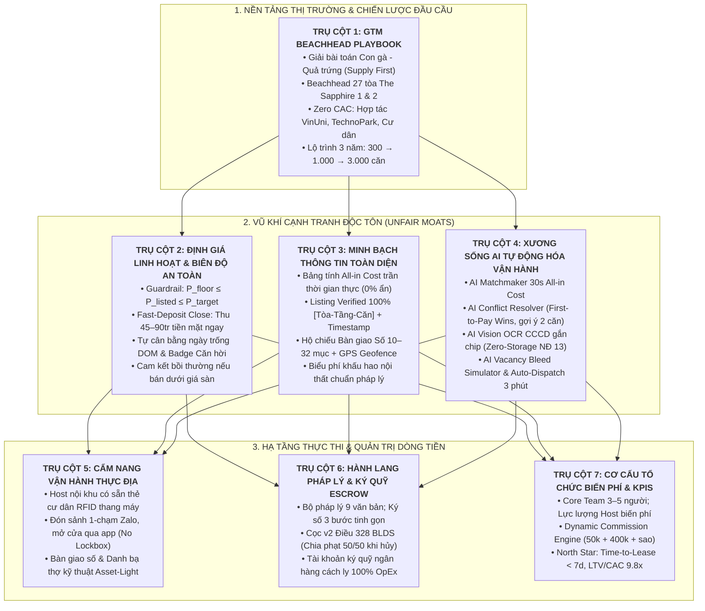
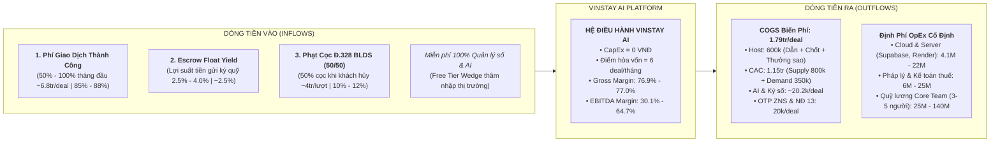
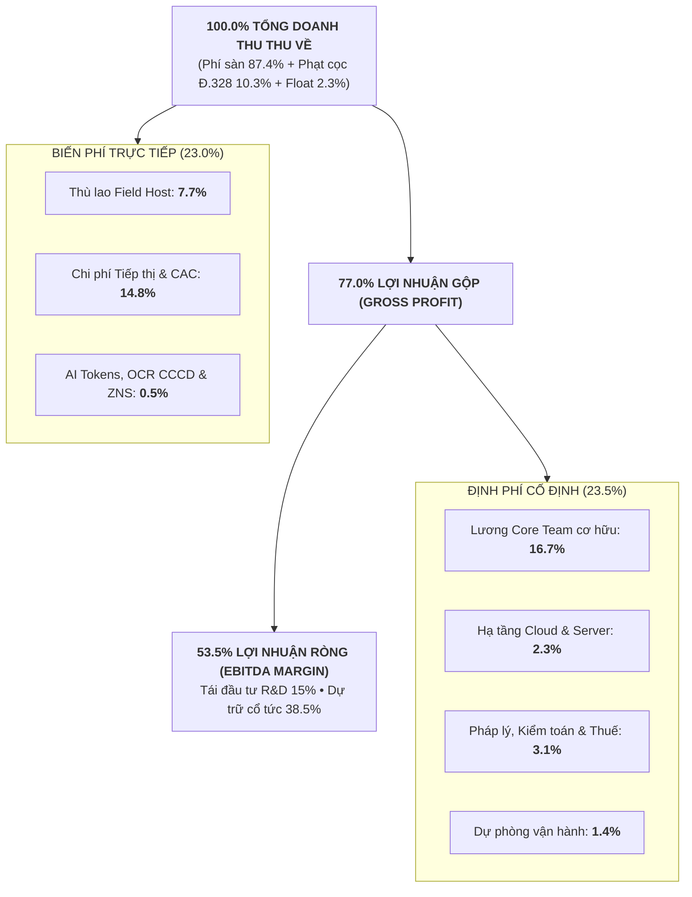

# VINSTAY AI — KẾ HOẠCH VẬN HÀNH & CHIẾN LƯỢC ĐƯA RA THỊ TRƯỜNG (GTM)
## HỆ THỐNG 7 TRỤ CỘT CHIẾN LƯỢC TOÀN DIỆN CHO DEMO DAY & GATE 3
*(THE 7-PILLAR GO-TO-MARKET, DYNAMIC PRICING & AI-POWERED OPERATIONS FRAMEWORK)*

> **Chương trình:** AI20K Build Phase — Cohort 4 (Vingroup x VinUniversity)  
> **Dự án:** VinStay AI — Hệ điều hành Cho thuê & Vận hành Căn hộ Tinh gọn (Asset-Light)  
> **Địa bàn triển khai:** Đại đô thị Vinhomes Ocean Park (Gia Lâm, Hà Nội)  
> **Phiên bản tài liệu:** v1.0 — Chuẩn hóa thẩm định Gate 3 & Bộ tài liệu Thuyết trình Demo Day  
> **Mốc hoàn thành:** 17/10/2026  
> **Tác giả / Phụ trách:** Nguyễn Khánh Duy (Tài chính & Pháp lý) cùng Đội ngũ P-010  

---

## MỤC LỤC CHI TIẾT
1. [TỔNG QUAN CHIẾN LƯỢC & SỨ MỆNH GIẢI QUYẾT NỖI ĐAU CỐT LÕI](#1-tổng-quan-chiến-lược--sứ-mệnh-giải-quyết-nỗi-đau-cốt-lõi)
2. [SƠ ĐỒ KIẾN TRÚC 7 TRỤ CỘT VẬN HÀNH & GTM TOÀN DIỆN](#2-sơ-đồ-kiến-trúc-7-trụ-cột-vận-hành--gtm-toàn-diện)
3. [CHI TIẾT 7 TRỤ CỘT CHIẾN LƯỢC (THE 7 STRATEGIC PILLARS)](#3-chi-tiết-7-trụ-cột-chiến-lược-the-7-strategic-pillars)
   - [Trụ cột 1: Chiến Lược Thâm Nhập Thị Trường Đầu Cầu (Beachhead GTM Playbook)](#trụ-cột-1-chiến-lược-thâm-nhập-thị-trường-đầu-cầu-beachhead-gtm-playbook)
   - [Trụ cột 2: Chiến Lược Định Giá Linh Hoạt & Biên Độ An Toàn (Dynamic Guardrail Pricing)](#trụ-cột-2-chiến-lược-định-giá-linh-hoạt--biên-độ-an-toàn-dynamic-guardrail-pricing)
   - [Trụ cột 3: Chiến Lược Minh Bạch Thông Tin Toàn Diện (Radical Transparency Engine)](#trụ-cột-3-chiến-lược-minh-bạch-thông-tin-toàn-diện-radical-transparency-engine)
   - [Trụ cột 4: Xương Sống Trí Tuệ Nhân Tạo Trong Vận Hành (AI Autonomous Backbone)](#trụ-cột-4-xương-sống-trí-tuệ-nhân-tạo-trong-vận-hành-ai-autonomous-backbone)
   - [Trụ cột 5: Cẩm Nang Vận Hành Thực Địa & Thẻ Cư Dân RFID (Field Operations Playbook)](#trụ-cột-5-cẩm-nang-vận-hành-thực-địa--thẻ-cư-dân-rfid-field-operations-playbook)
   - [Trụ cột 6: Hành Lang Pháp Lý, Ký Quỹ Escrow & Chế Tài Cọc (Legal & Escrow Governance)](#trụ-cột-6-hành-lang-pháp-lý-ký-quỹ-escrow--chế-tài-cọc-legal--escrow-governance)
   - [Trụ cột 7: Cơ Cấu Tổ Chức Biến Phí, North Star Metric & KPIs (Asset-Light Org & KPIs)](#trụ-cột-7-cơ-cấu-tổ-chức-biến-phí-north-star-metric--kpis-asset-light-org--kpis)
4. [BÀI TOÁN TÀI CHÍNH CHUYÊN SÂU: CẤU TRÚC THU - CHI, ĐỊNH PHÍ AI & BIÊN LỢI NHUẬN](#4-bài-toán-tài-chính-chuyên-sâu-cấu-trúc-thu---chi-định-phí-ai--biên-lợi-nhuận)
   - [4.1. Chi Tiết Cấu Trúc 4 Nhóm Nguồn Thu (Cash Inflows & Revenue Architecture)](#41-chi-tiết-cấu-trúc-4-nhóm-nguồn-thu-cash-inflows--revenue-architecture)
   - [4.2. Cấu Trúc Chi Phí Đầu Vào - Đầu Ra Toàn Diện (Cash Outflows: Fixed OpEx vs COGS)](#42-cấu-trúc-chi-phí-đầu-vào---đầu-ra-toàn-diện-cash-outflows-fixed-opex-vs-variable-cogs)
   - [4.3. Bóc Tách Tường Tận Chi Phí Trí Tuệ Nhân Tạo (AI Tokenomics Breakdown)](#43-bóc-tách-tường-tận-chi-phí-trí-tuệ-nhân-tạo-ai-tokenomics-breakdown)
   - [4.4. Bảng So Sánh Biên Lợi Nhuận & Dự Phóng Tài Chính Qua 4 Giai Đoạn](#44-bảng-so-sánh-biên-lợi-nhuận-margins--dự-phóng-tài-chính-qua-4-giai-đoạn)
   - [4.5. Sơ Đồ Thác Dòng Tiền & Dòng Luân Chuyển Tiền Mặt (Cashflow Waterfall)](#45-sơ-đồ-thác-dòng-tiền--dòng-luân-chuyển-tiền-mặt-cashflow-waterfall)
5. [KHUNG DÀN Ý 12 SLIDE BẢO VỆ ĐỀ ÁN DEMO DAY (PITCH DECK OUTLINE)](#5-khung-dàn-ý-12-slide-bảo-vệ-đề-án-demo-day-pitch-deck-outline)
6. [KỊCH BẢN PHÒNG THỦ & TRẢ LỜI PHẢN BIỆN GIÁM KHẢO (PITCH DEFENSE & Q&A GUIDE)](#6-kịch-bản-phòng-thủ--trả-lời-phản-biện-giám-khảo-pitch-defense--qa-guide)

---

## 1. TỔNG QUAN CHIẾN LƯỢC & SỨ MỆNH GIẢI QUYẾT NỖI ĐAU CỐT LÕI

Mô hình định lượng quy mô thị trường (**TAM 29.160 tỷ $\rightarrow$ SAM 1.440 tỷ $\rightarrow$ SOM 4.97 tỷ VNĐ**) chỉ chứng minh rằng *"địa hạt này rất tiềm năng"*. Tuy nhiên, một dự án khởi nghiệp chỉ có thể sống sót và sinh lời bền vững khi sở hữu một **Kế hoạch Vận hành Thực địa xuất sắc** và một **Chiến lược Đưa ra Thị trường (GTM) sắc bén**.

**VinStay AI** sinh ra để xóa bỏ hoàn toàn sự phân mảnh, thiếu minh bạch và lãng phí của môi giới truyền thống tại **Vinhomes Ocean Park (Gia Lâm, Hà Nội)**, bám sát 100% vào việc triệt tiêu:
* **4 Nỗi đau cốt lõi của Chủ nhà:** (1) Trống phòng kéo dài mất trắng tiền thuê & gánh nợ lãi vay; (2) Cực hình đi xa 20–30km mở cửa bị khách "bỏ bom"; (3) Tranh chấp hư hao nội thất & cọc không đủ bù sửa chữa; (4) Khủng hoảng bảo trì vặt & bị BQL phạt / bùng tiền điện nước EVN.
* **5 Nỗi đau cốt lõi của Khách thuê:** (1) Ma trận 60% tin ảo & tráo căn; (2) Sốc chi phí ẩn (phí QL, xe, điện nước); (3) Cực hình lạc đường đứng chờ môi giới tại sảnh; (4) Rủi ro lừa tiền cọc & hợp đồng bẫy; (5) Bị bỏ rơi sau khi dọn vào ở.
* **5 Điểm nghẽn vận hành của Đơn vị Quản lý:** (1) Rổ hàng bị "thiu"; (2) Khách và chủ nhà "cắt cầu" giao dịch ngoài; (3) Nỗi ám ảnh no-show; (4) Bẫy chi phí cố định (Fixed OpEx Trap); (5) Chậm trễ điều phối và tranh chấp Lead.

---

## 2. SƠ ĐỒ KIẾN TRÚC 7 TRỤ CỘT VẬN HÀNH & GTM TOÀN DIỆN



---

## 3. CHI TIẾT 7 TRỤ CỘT CHIẾN LƯỢC (THE 7 STRATEGIC PILLARS)

---

### TRỤ CỘT 1: CHIẾN LƯỢC THÂM NHẬP THỊ TRƯỜNG ĐẦU CẦU (BEACHHEAD GTM PLAYBOOK)

#### 1.1. Giải bài toán "Con gà & Quả trứng" (Two-Sided Liquidity Ignition):
* **Nguyên lý:** Trong thị trường BĐS cho thuê, **Nguồn cung chất lượng (Verified Supply) là mấu chốt quyết định**. Ai nắm giỏ hàng giá tốt, độc quyền thì khách thuê tự khắc đổ về mà không tốn chi phí quảng cáo lớn.
* **Chiến thuật "Khóa chặt Nguồn Cung trước (Supply-First)":**
  * Tung gói cam kết **"Chủ nhà ngồi tại nhà 100% — Cho thuê căn hộ không tốn 1 giọt xăng"**.
  * Ký **Hợp đồng Ký gửi Quản lý Độc quyền (Exclusive Mandate) 10 điều** với chính sách thoát linh hoạt sau 15 ngày báo trước (kèm trạng thái nhà trống), giúp chủ nhà hoàn toàn an tâm không lo bị giam lỏng tài sản.
  * Miễn phí 100% chi phí kiểm định hiện trạng và lập Hộ chiếu bàn giao số.

#### 1.2. Chiến lược Thị trường Đầu cầu (Beachhead Market — The Sapphire 1 & 2):
* **Tại sao chọn The Sapphire 1 & 2 làm bàn đạp số 1?**
  * *Quy mô rổ hàng:* Gồm 27 tòa chung cư với hơn $18.000$ căn hộ (chiếm hơn $40\%$ lượng căn hộ bàn giao của toàn dự án OCP 1).
  * *Mật độ cho thuê cao nhất:* Tỷ lệ chủ nhà mua đầu tư cho thuê đạt $38\% – 42\%$, tập trung chủ yếu căn hộ Studio, 1PN và 2PN có đơn giá thuê vừa túi tiền sinh viên và người đi làm ($5.5 – 10.0\text{ triệu/tháng}$).
  * *Tối ưu hóa cự ly Field Host:* Nằm kề sát khuôn viên Đại học VinUni và các trạm trung chuyển xe buýt điện VinBus. Cự ly di chuyển giữa các tòa trong cụm chỉ $150 – 300\text{m}$, cho phép 1 Field Host nội khu xử lý 3–4 ca xem phòng trong một buổi chiều với chi phí di chuyển bằng 0 VNĐ.

#### 1.3. Kênh Tiếp Cận Hạt Nhân Không Tốn Phí (Zero-CAC & Organic Flywheels):
* **Kênh Hút Khách Thuê (Demand Flywheels):**
  * **Đối tác Chiến lược B2B2C với VinUni:** Ký kết bảo trợ lưu trú với Hội Sinh viên và Phòng Công tác Sinh viên Đại học VinUni trước mùa nhập học (tháng 8–9).
  * **Standee & Kênh Doanh nghiệp tại TechnoPark Tower:** Tiếp cận trực tiếp $15.000$ kỹ sư và chuyên gia công nghệ qua ứng dụng nội bộ tòa nhà và standee quầy lễ tân.
  * **SEO Local & Video Content "Căn thật - Giá thật":** Video ngắn TikTok/Reels quay thực tế 60 giây không qua chỉnh sửa, nhắm trúng từ khóa *"Thuê căn hộ Ocean Park All-in"*.
* **Kênh Thu Hút Chủ Nhà (Supply Flywheels):**
  * Hợp tác với các Ban Quản trị lâm thời, Ban đại diện cư dân các tòa Sapphire 1 & 2.
  * Chương trình **"Cư dân giới thiệu Cư dân" (Referral Engine)**: Tặng 200.000 VNĐ cho cư dân giới thiệu thành công chủ nhà ký gửi căn hộ độc quyền.

#### 1.4. Lộ trình 3 Năm Mở rộng Quy mô (Scale-up Roadmap):
* **Năm 1 (Beachhead):** 300 căn độc quyền tại The Sapphire 1 & 2 (2.0% SAM) $\rightarrow$ Doanh thu **4.97 tỷ VNĐ**, EBITDA **+2.78 tỷ VNĐ**.
* **Năm 2 (Scale Up):** 1.000 căn phủ sóng toàn bộ 66 tòa Ocean Park 1 (Zenpark, Pavilion, Zurich, Masteri) $\rightarrow$ Doanh thu **16.12 tỷ VNĐ**, EBITDA **+10.07 tỷ VNĐ**.
* **Năm 3 (Expansion):** 3.000 căn mở rộng sang OCP 2, 3 và Vinhomes Smart City Tây Mỗ $\rightarrow$ Doanh thu **48.60 tỷ VNĐ**, EBITDA **+31.10 tỷ VNĐ**.

---

### TRỤ CỘT 2: CHIẾN LƯỢC ĐỊNH GIÁ LINH HOẠT & BIÊN ĐỘ AN TOÀN (DYNAMIC GUARDRAIL PRICING)

*(Bảo vệ dòng tiền chủ nhà và tối ưu tốc độ thanh khoản dưới 7 ngày — Căn cứ [`docs/DYNAMIC_PRICING_SPEC.md`](file:///Users/duy/P-010/docs/DYNAMIC_PRICING_SPEC.md))*

#### 2.1. Cam Kết Bất Biến Về Giá Sàn (AI Guardrail Invariant):
$$\forall t, \quad P_{\text{floor}} \le P_{\text{listed}}(t) \le P_{\text{target}}$$
* Chủ nhà xác lập mức **Giá sàn tối thiểu an toàn ($P_{\text{floor}}$)**: Đảm bảo $\ge 3.000.000$ VNĐ/tháng và nhỏ hơn hoặc bằng Giá chào thuê kỳ vọng. Giá sàn được **mã hóa bảo mật 100%**, tuyệt đối ẩn trên giao diện tìm kiếm của khách thuê.
* **Cam kết bồi thường:** Nếu hệ thống tự động chốt hợp đồng dưới mức Giá sàn ủy quyền, VinStay AI cam kết bồi thường $100\%$ khoản chênh lệch cho Chủ nhà.

#### 2.2. Thuật Toán Định Giá Đa Biến 4 Nhóm Trọng Số Theo Ngày Trống (DOM):
$$P_{\text{suggested}}(t) = P_{\text{ref}} \times \left(1 + \Delta_{\text{physical}} + \Delta_{\text{market}}\right) \times \delta_{\text{DOM}}(t)$$
* **Nhóm 1 ($P_{\text{ref}}$):** Giá tham chiếu thực tế của các căn cùng layout tại phân khu đã ký hợp đồng thật trong 30 ngày gần nhất (sử dụng hàm Median loại bỏ ngoại lai IQR).
* **Nhóm 2 ($\Delta_{\text{physical}}$):** Hệ số tầng ($-2\%$ đến $+3\%$), hướng ban công mát view hồ ($-3\%$ đến $+5\%$), và độ mới nội thất theo báo cáo kiểm định ($-5\%$ đến $+6\%$).
* **Nhóm 3 ($\Delta_{\text{market}}$):** Sức nóng hấp thụ rổ hàng phân khu trong 14 ngày (Mùa cao điểm $+4\%$).
* **Nhóm 4 ($\delta_{\text{DOM}}$):** Phân rã theo thời gian trống: Căn hộ trống $> 14$ ngày tự động điều chỉnh giảm nhẹ $2\% – 5\%$ trong biên độ an toàn, tự động kích hoạt **Huy hiệu "Căn hời phân khu" ($PCS \ge 10\%$)** đưa căn hộ lên Top đầu tìm kiếm và AI Matchmaker ưu tiên số 1.

#### 2.3. Cơ Chế Chốt Cọc Nhanh (Fast-Deposit Close Corridor — 2 Bước):
* **Bước 1 (Lúc cọc trong 24 giờ):** Khách chọn chốt cọc ngay trên web mà không cần đặt lịch đi xem thực địa $\rightarrow$ Được giảm ngay **5% tiền cọc** (tối thiểu 200.000 VNĐ, tối đa 8%). Tiền cọc về trong 24h khóa căn thành công.
* **Bước 2 (Lúc ký hợp đồng):** Khách cam kết chọn chu kỳ trả trước **1 / 3 / 6 tháng** để nhận mức chiết khấu giá thuê tương ứng **3.5% / 5.5% / 10%** (kẹp cứng $\ge$ Giá sàn an toàn).
* **Giá trị đột phá:** Mang về **45.000.000 – 90.000.000 VNĐ tiền mặt trả trước ngay lập tức** cho chủ nhà, rút ngắn thời gian tìm khách từ 30 ngày xuống chỉ còn 24 giờ, đồng thời giảm chi phí CAC xuống mức tối thiểu.

#### 2.4. Khung Chờ Dọn Vào Tiêu Chuẩn (Smart Move-in Window Protocol):
* Ngày dọn vào sớm nhất = T0 + 2 ngày (đệm 48h để BQL duyệt hồ sơ thẻ cư dân, đăng ký xe và Host kiểm tra hiện trạng).
* Khung chờ miễn phí tối đa 7 ngày (T0+2 đến T0+7). Nếu khách chọn dọn vào sau ngày thứ 7 (tối đa 30 ngày), hợp đồng và tiền thuê **bắt buộc tính bắt đầu từ ngày thứ 8 (T0+7)**, triệt tiêu 100% rủi ro bị giam căn trống không có tiền cho Chủ nhà.

---

### TRỤ CỘT 3: CHIẾN LƯỢC MINH BẠCH THÔNG TIN TOÀN DIỆN (RADICAL TRANSPARENCY ENGINE)

*(Triệt tiêu 100% "Ma trận tin ảo" và "Tranh chấp hư hao nội thất khi trả phòng")*

#### 3.1. Bảng Tính Trần All-in Cost Thời Gian Thực (Zero Hidden Cost):
* Bảng tính công khai trọn gói chi phí hàng tháng:
  $$\text{All-in Cost} = \text{Tiền thuê} + \text{Phí QL Vinhomes (9.5k/m}^2) + \text{Phí gửi xe (150k máy / 1.250k ô tô)} + \text{Dự toán điện nước EVN (300k/người)}$$
* Cam kết không phát sinh bất kỳ khoản phí môi giới hay phụ phí giấu kín nào khác. Khách thuê hoàn toàn chủ động ngân sách trước khi bấm xem phòng.

#### 3.2. Định Danh Chuẩn [Tòa – Tầng – Căn] & Ảnh Thực Tế Có Timestamp:
* 100% căn hộ niêm yết được Field Host thẩm định trực tiếp, gắn định danh minh bạch [Tòa – Tầng – Căn] (Ví dụ: `S1.02-1208`).
* Ảnh chụp góc rộng có dấu Watermark số định danh và Timestamp điện tử xác thực; đóng dấu watermark chống môi giới ngoài ăn cắp ảnh đăng tin mồi dìm giá thị trường.

#### 3.3. Hộ Chiếu Bàn Giao Số (Digital Handover Passport):
* Chụp ảnh kiểm định hiện trạng 10–32 hạng mục nội thất trọng yếu lúc nhận nhà (tường sơn, sàn gỗ, máy lạnh, tủ lạnh, sofa da, bếp, thiết bị vệ sinh) nhúng Timestamp + GPS Geofence $\le 50\text{m}$.
* Áp dụng **Quy chuẩn Định giá Khấu hao và Hư hại Nội thất** ([`legal/09_APPLIANCE_AND_FURNITURE_PRICING_PROTOCOL.md`](file:///Users/duy/P-010/legal/09_APPLIANCE_AND_FURNITURE_PRICING_PROTOCOL.md)):
  * Phân định rõ ràng: *Hao mòn tự nhiên theo thời gian* (Chủ nhà chịu) vs *Hư hỏng bất cẩn / cố ý* (Khách thuê bồi thường theo bảng giá niêm yết rõ ràng).
  * Chốt công tơ điện nước có ảnh chụp timestamp lúc nhận và trả phòng; đối soát dứt điểm tiền điện EVN và dịch vụ tồn đọng trước khi hoàn cọc, đảm bảo 0% nợ xấu cho chủ nhà.

---

### TRỤ CỘT 4: XƯƠNG SỐNG TRÍ TUỆ NHÂN TẠO TRONG VẬN HÀNH (AI AUTONOMOUS BACKBONE)

*(Tự động hóa toàn diện, vận hành tinh gọn không cần bộ máy cồng kềnh)*

```mermaid
flowchart LR
    subgraph AI_Engines ["AI OPERATIONAL ENGINES"]
        direction TB
        A1["<b>1. AI Matchmaker</b><br>Lọc 30s All-in Cost trần"]
        A2["<b>2. AI Conflict Resolver</b><br>First-to-Pay & Gợi ý 2 căn"]
        A3["<b>3. AI Vision OCR CCCD</b><br>Bóc tách 3s, Zero-Storage NĐ 13"]
        A4["<b>4. Vacancy Bleed Simulator</b><br>Mô phỏng thiệt hại nợ lãi ngân hàng"]
        A5["<b>5. Auto-Dispatch & SLA 3m</b><br>Điều phối Host & Escalation"]
        A6["<b>6. Quản Gia Vinny 3 Lớp</b><br>FAQ Cache 0đ & Chặn ngoài lề"]
    end

    subgraph Impacts ["TÁC ĐỘNG TÀI CHÍNH & VẬN HÀNH"]
        direction TB
        I1["Time-to-Lease < 7 ngày"]
        I2["Chốt sale kép, không hụt deal"]
        I3["Ký HĐ 3 bước chuẩn pháp lý"]
        I4["Thuyết phục chủ nhà hạ giá an toàn"]
        I5["Đón sảnh < 60s, SLA 100%"]
        I6["Chi phí Token AI ~20k/deal"]
    end

    AI_Engines --> Impacts
```



1. **AI Matchmaker theo All-in Cost (Khớp căn trong 30 giây):** Khách chỉ cần nhập nhu cầu và ngân sách All-in trần, thuật toán sàng lọc tự động đề xuất 3 căn hộ tối ưu nhất trong 30 giây.
2. **AI Conflict Resolver (Cơ chế First-to-Pay Wins & Đòn bẩy Chốt Sale Kép):** Khóa căn độc quyền theo giao dịch chuyển cọc thực tế gạch nợ tự động trong 60 giây. Nếu căn hộ bị cọc trực tuyến trong lúc đang có khách xem trực tiếp tại phòng, hệ thống tự động bắn cảnh báo đẩy cho Field Host và **gợi ý ngay 2 căn tương đương cùng phân khu ($\ge 90\%$ độ tương đồng)** để Host dẫn khách sang chốt cọc ngay, biến nguy cơ hụt căn thành cơ hội chốt sale kép.
3. **AI Vision OCR CCCD Gắn Chip (Zero-Storage Ephemeral Pipeline):** Tự động bóc tách thông tin 2 mặt thẻ CCCD gắn chip trong 3 giây để sinh hợp đồng thuê điện tử; tiêu hủy ảnh chụp gốc tức thì, mã hóa dữ liệu AES-256 tuân thủ nghiêm ngặt Nghị định 13/2023/NĐ-CP.
4. **AI Vacancy Bleed Simulator (Mô phỏng Thiệt hại Trống phòng Kép):** Khi chủ nhà muốn neo giá cao, AI đưa ra bảng toán học trực quan: tiền thuê mất trắng + phí quản lý BQL Vinhomes + nợ lãi vay ngân hàng + số tháng cho thuê cần thiết để bù lỗ, giúp chủ nhà tự nguyện điều chỉnh giá về vùng thanh khoản dưới 7 ngày mà không bị cảm giác môi giới ép giá.
5. **AI Auto-Dispatch & Auto-Escalation:** Phân bổ ca dẫn khách cho Field Host gần nhất trong 3 phút; hồ sơ ký gửi quá 2 giờ không có Host nhận sẽ tự động gán cho Area Lead và kích hoạt cảnh báo còi đỏ trên Admin Portal.
6. **Hệ thống Bảo vệ AI Chatbot 3 Lớp (Quản gia Vinny):**
   * *Lớp 1:* Rate limit 8 req/phút, giới hạn 15 câu chat cho khách vãng lai trước khi yêu cầu OTP.
   * *Lớp 2:* Zero-Cost Local Fast-Path FAQ Cache phản hồi tức thì (0đ token) cho các câu hỏi nội khu kinh điển (phí xe, phí QL, nội quy thú cưng, thẻ thang máy).
   * *Lớp 3:* Khóa cứng phạm vi chỉ trong Ocean Park, từ chối câu hỏi ngoài lề, khống chế output 200–250 tokens tiết kiệm 100% chi phí thừa.

---

### TRỤ CỘT 5: CẨM NANG VẬN HÀNH THỰC ĐỊA & THẺ CƯ DÂN RFID (FIELD OPERATIONS PLAYBOOK)

*(Giải phóng Chủ nhà ở nhà 100% — Cam kết SLA sảnh $< 3$ phút)*

#### 5.1. Mạng Lưới Field Host Nội Khu & Thẻ Cư Dân RFID Thang Máy:
* Field Host là các cư dân, sinh viên VinUni đang sinh sống ngay tại các phân khu Sapphire, Ruby, Zenpark.
* Host được trang bị sẵn **Thẻ cư dân thang máy RFID** do BQL Vinhomes cấp. Khách đến sảnh chỉ cần bấm nút 1-chạm Zalo, Host quẹt thẻ đưa khách lên phòng trong vòng **60 giây**, loại bỏ 100% cảnh đứng chờ bơ vơ tại sảnh hoặc đi ké thang máy vi phạm an ninh.

#### 5.2. Cơ Chế Cấp Mã Khóa Cửa Tức Thì (Tuyệt Đối Không Dùng Lockbox):
* Chủ nhà lưu mã khóa điện tử trên hệ thống (hoặc nhân sự phân khu giữ chìa khóa cơ tập trung).
* Khi dẫn khách tới trước cửa phòng, Host bấm **"Xác nhận xem phòng"** trên Mobile Web $\rightarrow$ Hệ thống tự động cấp mã mở cửa tức thì về điện thoại của Host để mở cửa đón khách.
* **Tuân thủ quy chế BQL 100%:** Tuyệt đối không treo hộp khóa Lockbox ở tay nắm cửa hành lang (hành vi vi phạm quy chế PCCC và thẩm mỹ của Vinhomes).

#### 5.3. Quy Trình Tiếp Đón Chuẩn Mực & Nhắc Hẹn Kép T-10m:
* Khách bắt buộc xác thực số điện thoại qua **Zalo OTP 1 lần** trước khi đặt lịch xem phòng.
* Hệ thống kích hoạt thông báo nhắc hẹn kép trước 10 phút: Báo Host chuẩn bị xuống sảnh, đồng thời gửi tin Zalo kèm nút 1-chạm *"Tôi đã có mặt tại sảnh"* cho khách, kéo giảm tỷ lệ no-show xuống dưới $5\%$.

#### 5.4. Danh Bạ Kỹ Thuật Ngoài & Mô Hình Vận Hành Asset-Light (Handyman Referral):
* VinStay AI và Field Host **tuyệt đối không ôm đồm bộ máy thợ sửa chữa cồng kềnh** và không chịu trách nhiệm bảo hành kỹ thuật.
* Khi căn hộ phát sinh sự cố (rỉ nước, chập điện), Host chỉ giới thiệu danh bạ thợ kỹ thuật ngoài uy tín tại Ocean Park; khách thuê và thợ tự thỏa thuận chi phí trực tiếp. Giải phóng chủ nhà khỏi cảnh bị gọi điện réo phiền lúc nửa đêm, duy trì mô hình siêu tinh gọn không rủi ro pháp lý.

---

### TRỤ CỘT 6: HÀNH LANG PHÁP LÝ, KÝ QUỸ ESCROW & CHẾ TÀI CỌC (LEGAL & ESCROW GOVERNANCE)

*(Bảo vệ an toàn tài sản, triệt tiêu nguy cơ cắt cầu giao dịch ngoài)*

#### 6.1. Chuẩn Hóa Cọc v2 Theo Điều 328 Bộ Luật Dân Sự 2015:
* **Chuyển ngay Tiền Cọc Bảo Đảm Tài Sản của căn:** Khách ưng ý chuyển ngay Tiền Cọc Bảo Đảm niêm yết của căn qua mã VietQR động NAPAS 247 (mặc định bằng **01 tháng tiền thuê**, chủ nhà cài đặt trong biên độ chính sách $0.5\times – 4.0\times$ trên Admin Portal). Không còn khoản cọc giữ chỗ 2.000.000 VNĐ cố định cũ.
* **Thời hạn giữ căn:** Căn hộ khóa trạng thái `holding` mặc định **48 giờ** (Admin tùy chỉnh từ 12 đến 72 giờ).
* **Nguyên tắc tài chính bất biến:** Khi ký Hợp đồng thuê chính thức, khoản tiền này được **chuyển đổi 100% thành Tiền Cọc Bảo Đảm Tài Sản & Nội Thất (Security Deposit)**, giữ nguyên suốt kỳ hạn thuê, **tuyệt đối KHÔNG khấu trừ vào tiền thuê tháng đầu tiên**, bảo toàn trọn vẹn tài sản cho chủ nhà.

#### 6.2. Cơ Chế Phân Chia Chế Tài Phạt Cọc (50% Chủ Nhà / 50% Sàn):
* **Khách thuê quá hạn / tự ý hủy cọc:** Bị mất toàn bộ số tiền đặt cọc theo quy định tại Khoản 2 Điều 328 BLDS 2015.
* **Công thức phân bổ dòng tiền phạt:**
  * **$50\%$ bồi thường cho Chủ nhà:** Bù đắp chi phí cơ hội trống phòng trong những ngày khóa căn (Ví dụ: nhận ngay 4.000.000 VNĐ đối với căn 8 triệu).
  * **$50\%$ nạp vào Doanh thu Sàn:** Bù đắp chi phí vận hành, marketing và thù lao dẫn khách cho Field Host.
* **Chủ nhà bẻ cọc / tăng giá:** Hoàn trả 100% cọc cho khách kèm khoản phạt cọc tương đương (tổng hoàn gấp 2 lần cọc).

#### 6.3. Tài Khoản Ký Quỹ Phong Tỏa Độc Lập (Escrow Account):
* 100% tiền cọc và tiền bảo đảm được luân chuyển và phong tỏa an toàn trong **Tài khoản Ký quỹ (Escrow Account)** mở tại Ngân hàng thương mại liên kết (Techcombank / MBBank), cách ly hoàn toàn khỏi tài khoản chi phí vận hành (OpEx) của công ty.
* Tiền ký quỹ nhàn rỗi được kết nối gói tiền gửi thanh toán doanh nghiệp (Sweep Account / Overnight Yield) với lãi suất an toàn **$2.5\% – 4.0\%/\text{năm}$**, mang về nguồn thu thụ động hàng trăm triệu đồng mỗi năm cho sàn.

#### 6.4. Bộ Pháp Lý 9 Văn Bản & Quy Trình Ký Số 3 Bước Tinh Gọn:
* Khách thuê tick đồng ý điều khoản cọc trực tiếp trên màn hình quét QR (bỏ bước ký thỏa thuận cọc riêng).
* Khi làm Hợp đồng thuê chính thức, thực hiện quy trình 3 bước: (1) AI OCR CCCD $\rightarrow$ (2) Khai báo danh sách cư trú tạm trú $\rightarrow$ (3) Ký số bằng chữ ký tay cảm ứng trên điện thoại thông qua mã xác thực OTP Zalo 1 lần, bảo đảm giá trị pháp lý đầy đủ theo Luật Giao dịch Điện tử 2023 và Luật Nhà ở 2023.

---

### TRỤ CỘT 7: CƠ CẤU TỔ CHỨC BIẾN PHÍ, NORTH STAR METRIC & KPIS (ASSET-LIGHT ORG & KPIS)

*(Tránh bẫy chi phí cố định — Đo lường sức khỏe tài chính theo thời gian thực)*

#### 7.1. Mô Hình Bộ Máy Tổ Chức Siêu Tinh Gọn (Core Team 3–5 Người):
* **Product & Tech Lead (01 người):** Quản trị hạ tầng Web/App, Backend API NestJS, CSDL Supabase, tích hợp AI và bảo mật thông tin.
* **Operations & Field Lead (01–02 người):** Tuyển dụng, đào tạo và giám sát mạng lưới Field Host nội khu tại Sapphire; kiểm soát chất lượng Hộ chiếu bàn giao số.
* **Business Development & Legal Lead (01 người):** Phát triển nguồn căn ký gửi độc quyền với Chủ nhà; đối soát ngân hàng ký quỹ và làm việc với BQL Vinhomes.
* **Lực lượng Field Host Cộng tác viên (Elastic Force):** 100% là nhân sự biến phí, không hưởng lương cứng, nhận thù lao tự động qua Ví Host sau mỗi tác vụ thành công.

#### 7.2. Bộ Công Cụ Thù Lao Lai 3 Tầng (Dynamic Commission & Incentive Engine):
Cấu hình trực tiếp trên Admin Portal (`AdminCommission.tsx`, `admin-fee.service.ts`):
* **Tầng 1 (Công sức):** Thù lao lượt dẫn khách: **$50.000 \text{ VNĐ / lượt dẫn}$** (nhận ngay sau khi mở cửa thành công).
* **Tầng 2 (Hiệu quả):** Hoa hồng chốt cọc thành công: **$400.000 \text{ VNĐ / hợp đồng}$** (chiếm 25%–35% phí sàn).
* **Tầng 3 (Chất lượng & Kích cầu):**
  * Hệ số nhân sao đánh giá: $\times \mathbf{1.2}$ nếu đạt $\ge 4.8\star$; $\times 0.8$ nếu $< 4.5\star$.
  * Thưởng nóng giải phóng căn tồn kho $> 21$ ngày: **$200.000 \text{ VNĐ / deal}$**.

#### 7.3. Chỉ Số Bắc Đẩu & Bộ Chỉ Số Hiệu Quả Kinh Tế (KPI Dashboard):

```
┌────────────────────────────────────────────────────────────────────────┐
│             VINSTAY AI — EXECUTIVE HEALTH DASHBOARD (KPIS)             │
├────────────────────────────────────────────────────────────────────────┤
│ 1. CHỈ SỐ BẮC ĐẨU (NORTH STAR METRICS):                                │
│    • Thời gian trung bình từ Ký gửi đến Chốt cọc:        < 7 NGÀY      │
│    • Tỷ lệ lấp đầy rổ hàng độc quyền (Occupancy Rate):   ≥ 78%         │
│                                                                        │
│ 2. CHỈ SỐ KINH TẾ ĐƠN VỊ (UNIT ECONOMICS):                             │
│    • Giá trị trọn đời trên mỗi căn hộ (LTV):        11.256.000 VNĐ     │
│    • Chi phí thu hút khách hàng (CAC):               1.150.000 VNĐ     │
│    • Tỷ số LTV / CAC:                                     9.8x         │
│    • Thời gian thu hồi chi phí CAC (Payback Period):  0.2 THÁNG        │
│    • Biên lợi nhuận ròng (Net Margin):             55.8% - 64.0%       │
│                                                                        │
│ 3. CHỈ SỐ VẬN HÀNH THỰC ĐỊA (OPERATIONAL SLAS):                        │
│    • SLA tiếp nhận ca dẫn khách của Field Host:          < 3 PHÚT      │
│    • Thời gian đón sảnh & đưa khách lên phòng:           < 60 GIÂY     │
│    • Tỷ lệ khách có mặt thực tế tại sảnh (Show Rate):     ≥ 80%        │
│    • Tỷ lệ khách hủy hẹn / bỏ bom (No-show Rate):         < 5%         │
│    • Điểm đánh giá chất lượng Host trung bình:           ≥ 4.8 / 5.0★  │
│    • Điểm hòa vốn vận hành toàn sàn:                 6 DEAL / THÁNG    │
└────────────────────────────────────────────────────────────────────────┘
```

---

## 4. BÀI TOÁN TÀI CHÍNH CHUYÊN SÂU: CẤU TRÚC THU - CHI, ĐỊNH PHÍ AI & BIÊN LỢI NHUẬN

Mô hình tài chính của **VinStay AI** được xây dựng dựa trên nguyên lý **Siêu Tinh Gọn (Ultra Asset-Light)** và **Biến phí hóa tối đa (Variable-Cost Driven)**. Thay vì áp dụng phí phần mềm định kỳ gây rào cản tiếp cận trong giai đoạn đầu, nền tảng tập trung tối đa vào **Phí Giao Dịch Thành Công (Success-based Fee)** kết hợp **Lợi tức Ký quỹ Kép (Escrow Float Yield)** và **Cơ chế Phân chia Phạt Cọc Minh Bạch (Điều 328 BLDS)**. Toàn bộ tính năng số hóa (Hộ chiếu số nội thất, Quản gia AI Vinny, quản lý hợp đồng) được cung cấp **HOÀN TOÀN MIỄN PHÍ** để làm đòn bẩy thâm nhập thị trường thần tốc (Zero Friction Growth Wedge):



---

### 4.1. Chi Tiết Cấu Trúc Nguồn Thu Tinh Gọn (Cash Inflows & Revenue Architecture)

| Nhóm Nguồn Thu | Đối tượng chi trả & Cơ chế thanh toán | Định mức đơn giá niêm yết | Tỷ trọng Doanh thu | Ý nghĩa chiến lược & Bảo đảm dòng tiền |
|---|---|---|:---:|---|
| **1. Phí Giao Dịch Thành Công (Success-based Fee)** | **Chủ nhà chi trả** ngay khi giao kết Hợp đồng thuê 3 bước thành công. Khấu trừ trực tiếp từ kỳ thanh toán đầu tiên của khách. | • HĐ 6 tháng: **50% tiền thuê tháng đầu** (3.5 – 5.5 triệu).<br>• HĐ 12 tháng: **100% tiền thuê tháng đầu** (7.0 – 11.0 triệu).<br>• **Blended Value: 6.800.000 VNĐ / deal**. | **$85.0\% – 87.5\%$** *(Nguồn thu chủ lực)* | Căn hộ áp dụng **Fast-Deposit Close** (khách trả trước 3–6 tháng) giúp sàn thu trọn gói 100% hoa hồng ngay thời điểm ký kết, **triệt tiêu 100% nợ đọng hoa hồng**. |
| **2. Lãi Suất Tạm Giữ Ký Quỹ Độc Lập (Escrow Float Income)** | **Ngân hàng thương mại liên kết** chi trả lợi tức định kỳ trên số dư tiền gửi ký quỹ khả dụng (Tài khoản Escrow phong tỏa). | Gói tiền gửi thanh toán doanh nghiệp tự động (Sweep Account): **$2.5\% – 4.0\% / \text{năm}$** trên số dư tối thiểu. | **$2.0\% – 3.0\%$** *(Lợi tức thụ động an toàn)* | Vì cọc giữ chỗ chuyển thành **Tiền Cọc Bảo Đảm v2 (bình quân 8.000.000 VNĐ/căn)**, số dư ký quỹ đệm tăng gấp 4 lần so với mức 2 triệu cũ: 50 căn $\approx$ 500M (1.5M/tháng); 300 căn $\approx$ 3 tỷ (9M/tháng); 1.000 căn $\approx$ 10 tỷ (30M/tháng). |
| **3. Doanh Thu Phân Chia Phạt Cọc Đ.328 BLDS (Deposit Forfeiture)** | **Trích từ tiền đặt cọc** của khách thuê tự ý hủy hẹn hoặc quá hạn giữ căn 48 giờ vì lý do chủ quan (Khoản 2 Điều 328 BLDS 2015). | Chia **50% Chủ nhà / 50% Nền tảng**.<br>Mỗi ca hủy cọc, sàn thu về: **4.000.000 VNĐ / lượt**. | **$9.5\% – 12.0\%$** *(Quỹ dự phòng rủi ro)* | Tỷ lệ drop-off phễu cọc thực tế là $16.7\%$ (10 deal hủy/tháng trên 60 deal holding). Sàn thu về **40.000.000 VNĐ / tháng**, bù đắp trực tiếp thù lao dẫn khách cho Field Host và chi phí marketing cho các ca không thành công. |
| **4. Công Cụ Số Hóa & Quản Gia AI (Freemium Growth Wedge)** | **MIỄN PHÍ 100% cho cả Chủ nhà và Khách thuê** trong toàn bộ giai đoạn thâm nhập thị trường (Pilot & Scale Up). | • Hộ chiếu bàn giao số 10–32 mục: **0 VNĐ**.<br>• Quản gia AI Vinny & Bảng All-in Cost: **0 VNĐ**.<br>• Đối soát điện nước EVN & hóa đơn: **0 VNĐ**. | **$0.0\%$ (Chi phí tiếp thị = 0)** | **Chiến lược thâm nhập không rào cản:** Chủ nhà và khách thuê không bị tính phí định kỳ, triệt tiêu 100% rào cản gia nhập. Toàn bộ công nghệ được tài trợ bởi Phí giao dịch thành công. Chỉ xem xét mở rộng các gói Premium Add-on khi đạt quy mô $\ge 3.000$ căn. |

---

### 4.2. Cấu Trúc Chi Phí Đầu Vào - Đầu Ra Toàn Diện (Cash Outflows: Fixed OpEx vs Variable COGS)

Hệ thống phân rã nghiêm ngặt giữa **Định phí cố định (Fixed OpEx)** và **Biến phí trực tiếp trên mỗi giao dịch (Unit Variable COGS)** để bảo đảm tỷ suất lợi nhuận gộp luôn đạt $\ge 77\%$:

#### A. Chi phí Đầu vào Cố định Hàng tháng (Fixed OpEx):
1. **Hạ tầng Cloud & Server Serverless (4.1M – 22.0M VNĐ/tháng):**
   * *Frontend & CDN:* Vercel Pro Tier ($20 USD/seat).
   * *Backend API Live:* Render Web Service (Node.js 24 NestJS, auto-restart, health-check).
   * *Cơ sở dữ liệu:* Supabase Pro Tier ($25 USD/tháng kèm 8GB DB, Daily Backups, PITR, pgvector tích hợp).
   * *Bộ nhớ đệm & Queue:* Upstash Serverless Redis ($0.2/100k requests).
   * *Tường lửa & WAF:* Cloudflare Pro chống DDoS, SSL nâng cao.
   * *Email doanh nghiệp & Sentry Logs:* Google Workspace (3 user) + Sentry Developer.
2. **Chi phí Pháp lý, Kế toán, Kiểm toán & Tuân thủ (6.0M – 25.0M VNĐ/tháng):**
   * Phí tư vấn luật sư chuyên ngành BĐS duy trì biểu mẫu (2.0M/tháng).
   * Phí dịch vụ kế toán thuế & kiểm toán định danh (3.0M/tháng).
   * Phí duy trì kết nối cổng VietQR NAPAS 247 & Webhook ngân hàng (500k – 1.0M/tháng).
3. **Quỹ lương Đội ngũ Vận hành Cốt lõi — Core Team 3–5 người (25.0M – 140.0M VNĐ/tháng):**
   * 01 Product & Tech Lead (Toàn quyền hệ thống, AI, bảo mật).
   * 01–02 Operations Lead (Tuyển dụng, giám sát Field Host, đối soát hiện trường).
   * 01 BD & Legal Lead (Mở rộng rổ hàng chủ nhà, quan hệ BQL Vinhomes và Ngân hàng).

#### B. Chi phí Đầu ra Biến phí trên Mỗi Giao Dịch Thành Công (Unit Variable Costs - COGS):

$$\text{Tổng Biến Phí / Deal} = \text{Thù lao Host (600k)} + \text{CAC Phân Bổ (1.15tr)} + \text{AI Tokens & OCR (20.2k)} + \text{OTP & Ký số (20k)} = \mathbf{1.790.000 \text{ VNĐ / deal}}$$

* **1. Thù lao & Hoa hồng Field Host (600.000 VNĐ / deal):**
  * Thù lao lượt dẫn khách thực địa: 3 ca xem phòng $\times 50.000\text{đ} = 150.000$ VNĐ.
  * Hoa hồng chốt cọc thành công: $400.000$ VNĐ.
  * Thưởng chất lượng dịch vụ sao rating $\ge 4.8\star$ ($\times 1.2$): $50.000$ VNĐ.
* **2. Chi phí Thu hút Khách hàng Hai Đầu (CAC Attribution = 1.150.000 VNĐ / deal):**
  * *Supply CAC (Thu hút Chủ nhà):* $800.000$ VNĐ/deal (Paid Ads Target 360k, Thưởng giới thiệu cư dân 200k, Host khảo sát thẩm định 240k).
  * *Demand CAC (Thu hút Khách thuê):* $350.000$ VNĐ/deal (Tài trợ sự kiện VinUni/TechnoPark 120k, TikTok/SEO 110k, Zalo ZNS 20k, Bù ca dẫn không chốt 100k).
* **3. Chi phí AI & Xác thực CCCD:** $20.200$ VNĐ / deal (Bóc tách chi tiết tại Mục 4.3).
* **4. Chi phí Ký HĐ Thuê Điện Tử & Mã Hóa NĐ 13:** $20.000$ VNĐ / deal.

---

### 4.3. Bóc Tách Tường Tận Chi Phí Trí Tuệ Nhân Tạo (AI Tokenomics Breakdown)

VinStay AI áp dụng triết lý **"Vận hành AI Tiết Kiệm Tối Đa (Cost-Conscious AI Ops)"** với kiến trúc 3 lớp bảo vệ giúp khống chế chi phí AI chỉ chiếm **$< 0.3\%$** doanh thu mỗi deal:

| Hạng mục AI & Xác thực | Nhà cung cấp & Mô hình | Thông số Kỹ thuật & Định mức Token | Đơn giá thị trường | Chi phí thực tế trên 01 Deal thành công |
|---|---|---|---|:---:|
| **1. AI Matchmaker (Lọc All-in Cost trần)** | OpenAI GPT-4o-mini / Google Gemini 1.5 Flash | • Input: 800 tokens (Prompt tiêu chí + Context 10 căn giỏ hàng)<br>• Output: 250 tokens (Top 3 căn + Bảng All-in Cost)<br>• Định mức: Bình quân 3 lượt lọc/deal | • Input: $0.15 / 1M tokens (~3.75đ / 1k)<br>• Output: $0.60 / 1M tokens (~15đ / 1k) | **~15.000 VNĐ** |
| **2. AI Vision OCR CCCD Gắn Chip (Zero-Storage)** | FPT.AI eKYC / VNPT eKYC Engine | Bóc tách tự động 2 mặt thẻ CCCD gắn chip + Face Liveness check 3 giây; tiêu hủy ảnh gốc tức thì | 1.800 – 2.500 VNĐ / request bóc tách 2 mặt | **~4.000 VNĐ** |
| **3. Xác thực OTP Zalo ZNS & Nhắc hẹn T-10m** | Zalo Notification Service (ZNS) | 1 tin ZNS gửi mã OTP đăng ký + 2 tin ZNS nhắc hẹn trước 10 phút kèm nút 1-chạm xác nhận sảnh | 350 – 400 VNĐ / tin ZNS | **~1.200 VNĐ** |
| **4. Ký Hợp đồng Thuê Điện Tử 3 Bước** | Web v0.9.2 In-house Engine | Ký bằng chữ ký tay cảm ứng (Hand Signature Canvas) + OTP Consent; mã hóa AES-256 nội bộ | Giải pháp In-house tích hợp sẵn | **0 VNĐ** |
| **5. Embedding & Semantic Search Vector DB** | Pgvector (Extension nội bộ Supabase Postgres) | Tạo và lưu trữ vector đặc trưng căn hộ và tiêu chí người thuê; tìm kiếm khoảng cách Cosine | Tích hợp sẵn trong gói Supabase Pro | **0 VNĐ** |
| **6. Local Fast-Path FAQ Cache (Zero-Cost Layer)** | Upstash Redis | Tự động nhận diện và phản hồi tức thì cho 80% câu hỏi nội khu kinh điển (phí xe, phí QL, thú cưng) | 0đ API Token (bộ đệm Local Cache) | **0 VNĐ** |
| **TỔNG CHI PHÍ AI & XÁC THỰC TRÊN MỖI GIAO DỊCH** | | | | **~20.200 VNĐ / deal** |

#### Dự toán Chi phí AI Toàn sàn Hàng tháng qua 4 Giai đoạn:
* **Giai đoạn 1 (Pilot 50 căn — 10 deal/tháng):** 10 deal $\times$ 20.2k + Serverless overhead $\approx$ **1.100.000 VNĐ / tháng** (~44 USD).
* **Giai đoạn 2 (Scale Up 300 căn — 50 deal/tháng):** 50 deal $\times$ 20.2k + 1.500 lượt chat Quản gia Vinny $\approx$ **5.200.000 VNĐ / tháng** (~208 USD).
* **Giai đoạn 3 (Expansion 1.000 căn — 160 deal/tháng):** 160 deal $\times$ 20.2k + 6.000 lượt chat $\approx$ **16.500.000 VNĐ / tháng** (~660 USD).
* **Giai đoạn 4 (Maturity 3.000 căn — 480 deal/tháng):** 480 deal $\times$ 20.2k + 20.000 lượt chat $\approx$ **49.500.000 VNĐ / tháng** (~1.980 USD).

---

### 4.4. Bảng So Sánh Biên Lợi Nhuận (Margins) & Dự Phóng Tài Chính Qua 4 Giai Đoạn

Bảng P&L đối chiếu đầy đủ sức khỏe tài chính và biên lợi nhuận của VinStay AI theo từng mốc quy mô phát triển (đã loại bỏ phí SaaS định kỳ, tập trung vào 3 nguồn thu thực tế):

| Chỉ số tài chính (Đơn vị tính: VNĐ) | Giai đoạn 1: Pilot MVP<br>**(50 căn hộ Sapphire)** | Giai đoạn 2: Scale Up<br>**(300 căn hộ OCP 1)** | Giai đoạn 3: Expansion<br>**(1.000 căn Quần thể)** | Giai đoạn 4: Maturity<br>**(3.000 căn HN Hub)** |
|---|:---:|:---:|:---:|:---:|
| **Số căn hộ hoạt động đồng thời** | 50 căn | 300 căn | 1.000 căn | 3.000 căn |
| **Sản lượng deal chốt mới bình quân / tháng** | 10 deal | 50 deal | 160 deal | 480 deal |
| **Số ca hủy cọc phân chia Đ.328 BLDS / tháng** | 2 deal | 10 deal | 32 deal | 96 deal |
| **1. DOANH THU BÌNH QUÂN HÀNG THÁNG** | | | | |
| • Doanh thu Phí giao dịch (6.8tr/deal thành công) | 68.000.000 | 340.000.000 | 1.088.000.000 | 3.264.000.000 |
| • Lợi suất tiền gửi ký quỹ (Escrow Float Yield 3.5%) | 1.500.000 | 9.000.000 | 30.000.000 | 90.000.000 |
| • Doanh thu phân chia phạt cọc Đ.328 BLDS (50/50) | 8.000.000 | 40.000.000 | 128.000.000 | 384.000.000 |
| • Tiện ích Quản lý số & AI Vinny (Freemium Hook) | 0 *(Miễn phí)* | 0 *(Miễn phí)* | 0 *(Miễn phí)* | 0 *(Miễn phí)* |
| **TỔNG DOANH THU THÁNG** | **77.500.000** | **389.000.000** | **1.246.000.000** | **3.738.000.000** |
| *(Tương đương Doanh thu quy năm)* | *(930.000.000)* | *(4.668.000.000)* | *(14.952.000.000)* | *(44.856.000.000)* |
| **2. BIẾN PHÍ TRỰC TIẾP (COGS / THÁNG)** | | | | |
| • Thù lao Field Host (Viewing + Success + Star) | 6.000.000 | 30.000.000 | 96.000.000 | 288.000.000 |
| • Chi phí Tiếp thị & Thu hút hai đầu (CAC phân bổ) | 11.500.000 | 57.500.000 | 184.000.000 | 552.000.000 |
| • Chi phí AI Engine, Vision OCR & Zalo ZNS | 202.000 | 1.010.000 | 3.232.000 | 9.696.000 |
| • Chi phí ký số OTP & Mã hóa NĐ 13 | 200.000 | 1.000.000 | 3.200.000 | 9.600.000 |
| **TỔNG BIẾN PHÍ (COGS / THÁNG)** | **17.902.000** | **89.510.000** | **286.432.000** | **859.296.000** |
| **3. LỢI NHUẬN GỘP THÁNG (GROSS PROFIT = 1 - 2)** | **59.598.000** | **299.490.000** | **959.568.000** | **2.878.704.000** |
| **TỶ SUẤT LỢI NHUẬN GỘP (GROSS MARGIN)** | **76.9%** | **77.0%** | **77.0%** | **77.0%** |
| **4. ĐỊNH PHÍ VẬN HÀNH THÁNG (FIXED OPEX)** | | | | |
| • Hạ tầng Cloud, Server, Database & Render | 4.100.000 | 9.050.000 | 22.000.000 | 45.000.000 |
| • Chi phí Pháp lý, Kế toán, Thuế & Cổng VietQR | 6.000.000 | 12.000.000 | 25.000.000 | 50.000.000 |
| • Lương Đội ngũ Vận hành Cốt lõi (Core Team) | 25.000.000 | 65.000.000 | 140.000.000 | 320.000.000 |
| • Dự phòng vận hành & Chi phí khác | 1.198.000 | 5.190.000 | 18.068.000 | 45.000.000 |
| **TỔNG ĐỊNH PHÍ (FIXED OPEX / THÁNG)** | **36.298.000** | **91.240.000** | **205.068.000** | **460.000.000** |
| **5. LỢI NHUẬN TRƯỚC THUẾ (EBITDA / THÁNG)** | **+23.300.000** | **+208.250.000** | **+754.500.000** | **+2.418.704.000** |
| *(Tương đương EBITDA quy năm)* | *(+279.600.000)* | *(+2.499.000.000)* | *(+9.054.000.000)* | *(+29.024.448.000)* |
| **TỶ SUẤT LỢI NHUẬN RÒNG (NET MARGIN)** | **30.1%** | **53.5%** | **60.6%** | **64.7%** |
| **SỐ DEAL HÒA VỐN TỐI THIỂU / THÁNG** | **6 DEAL** | **16 DEAL** | **35 DEAL** | **78 DEAL** |

---

### 4.5. Sơ Đồ Thác Dòng Tiền & Dòng Luân Chuyển Tiền Mặt (Cashflow Waterfall)

Mô hình phân rã 100 VNĐ Doanh thu thu về trên mỗi giao dịch tại quy mô Scale Up (Giai đoạn 2):



> **ĐÁNH GIÁ CHỈ SỐ AN TOÀN TÀI CHÍNH (KEY TAKEAWAYS):**
> 1. **Biên lợi nhuận gộp vững chắc $\ge 77\%$:** Mặc dù hoàn toàn miễn phí gói số hóa, biên lợi nhuận gộp vẫn đạt mức xuất sắc ($77.0\%$). Chi phí biến phí trên mỗi deal chỉ là $1.790.000$ VNĐ trong khi doanh thu thu về bình quân là $7.780.000$ VNĐ/deal.
> 2. **Điểm hòa vốn siêu thấp (6 deal / tháng tại Pilot):** Với mỗi deal đóng góp thặng dư $\approx 5.960.000$ VNĐ, nền tảng chỉ cần chốt thành công đúng **6 căn hộ/tháng** là hoàn toàn trang trải 100% chi phí hạ tầng cloud, kiểm toán pháp lý và toàn bộ quỹ lương đội ngũ sáng lập.
> 3. **Chi phí AI siêu tối ưu (chỉ $0.5\%$ doanh thu):** Áp dụng kiến trúc Zero-Cost FAQ Cache và Zero-Storage Ephemeral OCR giúp nền tảng không bao giờ bị "vỡ trận" chi phí API khi lượng người dùng tăng đột biến.

---

## 5. KHUNG DÀN Ý 12 SLIDE BẢO VỆ ĐỀ ÁN DEMO DAY (PITCH DECK OUTLINE)

| Slide # | Tiêu Đề Slide | Thông Điệp Cốt Lõi Cần Truyền Tải (Key Takeaway) | Visual / Chart Đề Xuất |
|:---:|---|---|---|
| **Slide 1** | **Title & Vision** | **VinStay AI** — Hệ điều hành Cho thuê & Vận hành Căn hộ Tinh gọn số 1 tại Vinhomes Ocean Park. | Logo, Slogan, Mockup App di động hiện đại. |
| **Slide 2** | **The Pain Points** | 4 Nỗi đau nhức nhối của Chủ nhà (Trống phòng, đi xa mở cửa, hư nội thất, BQL phạt) & 5 Nỗi đau Khách thuê (Tin ảo, chi phí ẩn). | Bảng đối chiếu nỗi đau 2 đầu kèm số liệu thiệt hại thực tế (Mất 6–12tr/tháng). |
| **Slide 3** | **The Solution** | Nền tảng PropTech All-in-One: Chủ nhà ở nhà 100%, khách thuê biết trọn gói All-in Cost trong 30 giây. | Video 30s quy trình: Quét All-in Cost $\rightarrow$ Host đón sảnh $\rightarrow$ Quét VietQR cọc 48h. |
| **Slide 4** | **Market Size (TAM-SAM-SOM)** | Thị trường 29.160 tỷ GMV tại 2 đô thị; SAM 1.440 tỷ tại Ocean Park 1; SOM Năm 1 đạt 4.97 tỷ VNĐ với 300 căn Sapphire. | Biểu đồ phễu **Market Waterfall** (TAM $\rightarrow$ SAM $\rightarrow$ SOM). |
| **Slide 5** | **Dynamic Guardrail Pricing & Fast-Close** | Thuật toán định giá 4 trọng số kẹp Giá sàn an toàn $\ge 3$ triệu; Fast-Deposit Close gom ngay 45–90 triệu tiền mặt trả trước. | Đồ thị biên độ an toàn $P_{\text{floor}} \le P_{\text{listed}} \le P_{\text{target}}$ & Badge Căn hời. |
| **Slide 6** | **Radical Transparency & Handover Passport** | Công khai 100% All-in Cost; Hộ chiếu bàn giao số 10–32 mục nhúng Timestamp + GPS Geofence triệt tiêu tranh chấp. | Ảnh mẫu Hộ chiếu bàn giao số có dấu Watermark và GPS Geofence tại căn hộ. |
| **Slide 7** | **AI Autonomous Backbone** | Bộ 5 động cơ AI: Matchmaker 30s, Conflict Resolver First-to-Pay, OCR CCCD Zero-Storage, Vacancy Bleed Simulator. | Sơ đồ luồng AI tự động hóa khép kín không can thiệp thủ công. |
| **Slide 8** | **Asset-Light Field Ops & RFID Network** | Mạng lưới Field Host nội khu có sẵn thẻ cư dân RFID thang máy; SLA đón sảnh $< 3$ phút; tuyệt đối không dùng Lockbox. | Bản đồ nhiệt mạng lưới Field Host tại cụm Sapphire 1 & 2. |
| **Slide 9** | **Legal, Escrow & Deposit v2** | Cọc v2 theo Điều 328 BLDS (chia 50/50 khi hủy); Tài khoản ký quỹ Escrow độc lập; Tuân thủ Nghị định 13/2023/NĐ-CP. | Sơ đồ dòng tiền Escrow độc lập phân tách hoàn toàn khỏi tài khoản OpEx sàn. |
| **Slide 10** | **Business Model & Financial Projections** | 3 Dòng thu cốt lõi (Phí sàn thành công 87%, Phạt cọc Đ.328 chia 50/50 10%, Escrow Float 3%); Miễn phí 100% SaaS làm đòn bẩy thâm nhập; Doanh thu Năm 1: 4.67 tỷ $\rightarrow$ Năm 3: 44.8 tỷ; EBITDA Margin $53.5\% – 64.7\%$; Hòa vốn chỉ cần 6 deal/tháng. | Bảng P&L 3 giai đoạn và biểu đồ cột doanh thu/lợi nhuận tăng trưởng. |
| **Slide 11** | **Unit Economics & Traction** | LTV/CAC = 7.6x; Payback = 0.2 tháng; Giỏ hàng 50 căn Pilot Sapphire đã sẵn sàng; Web/App và Backend API Live 100%. | ASCII Dashboard KPI sức khỏe tài chính & ảnh chụp màn hình Dashboard Admin. |
| **Slide 12** | **Core Team & The Ask** | Đội ngũ sáng lập AI20K am hiểu sâu sắc thực địa Ocean Park, chuyên môn AI & Pháp lý BĐS; Kế hoạch gọi vốn Seed Round. | Ảnh chân dung Core Team, phân công nhiệm vụ và cột mốc kế hoạch 12 tháng tới. |

---

## 6. KỊCH BẢN PHÒNG THỦ & TRẢ LỜI PHẢN BIỆN GIÁM KHẢO (PITCH DEFENSE & Q&A GUIDE)

#### Câu hỏi 1: *"Nếu sau khi Field Host dẫn xem phòng xong, Khách thuê và Chủ nhà tự xin số nhau để giao dịch ngầm ngoài sàn (Cắt cầu - Platform Leakage) thì VinStay AI xử lý thế nào?"*
* **Trả lời phản biện:**
  1. **Ràng buộc pháp lý từ Hợp đồng Ký gửi Độc quyền 10 điều:** Chủ nhà đã ủy quyền độc quyền; nếu phát hiện giao dịch ngầm trong thời hạn hiệu lực, chủ nhà bị phạt 100% tiền hoa hồng theo điều khoản chế tài.
  2. **Số điện thoại hai đầu được mã hóa 100%:** Khách và chủ nhà không nhìn thấy số của nhau trên hệ thống; mọi liên lạc đều qua Nền tảng.
  3. **Lợi ích tài chính của Ký quỹ & Hộ chiếu bàn giao số:** Khách thuê chỉ được bảo lãnh hoàn cọc trong 60 giây và Chủ nhà chỉ được bảo vệ tài sản bằng Hộ chiếu số nhúng Timestamp khi giao dịch thành công trên sàn. Nếu giao dịch ngoài, khách đối mặt rủi ro lừa cọc và chủ nhà tự chịu 100% chi phí khi khách làm hỏng nội thất hoặc bùng tiền điện nước EVN.
  4. **Cơ chế First-to-Pay cọc VietQR:** Khách ưng ý thường chuyển cọc ngay qua app để khóa căn độc quyền, không còn thời gian dây dưa thỏa thuận ngầm.

#### Câu hỏi 2: *"Mô hình Dynamic Pricing có nguy cơ làm Chủ nhà phản đối vì cho rằng AI tự ý dìm giá căn hộ của họ không?"*
* **Trả lời phản biện:**
  1. **Tuyệt đối bảo vệ Giá sàn ($P_{\text{floor}}$):** Chủ nhà là người trực tiếp xác lập mức Giá sàn tối thiểu an toàn để trang trải nợ gốc/lãi ngân hàng. AI chỉ được tối ưu trong biên độ từ Giá sàn đến Giá kỳ vọng ($P_{\text{floor}} \le P_{\text{listed}} \le P_{\text{target}}$).
  2. **Công cụ AI Vacancy Bleed Simulator:** Thay vì tranh cãi cảm tính, AI đưa ra bài toán kinh tế: Neo giá cao hơn 500k nhưng để trống thêm 1 tháng thì mất trắng 8 triệu tiền thuê + 500k phí QL tòa nhà; phải cho thuê liên tục 17 tháng sau đó mới gỡ lại được lỗ trống phòng 1 tháng. Đa số chủ nhà nhìn thấy con số toán học đều tự nguyện chọn mức giá cạnh tranh để cắn cọc nhanh.
  3. **Cam kết bồi thường 100%:** Nếu hệ thống vi phạm chốt deal dưới mức Giá sàn ủy quyền, VinStay AI bồi thường toàn bộ phần chênh lệch cho chủ nhà.

#### Câu hỏi 3: *"Tại sao VinStay AI không đầu tư lắp đặt Khóa thông minh IoT / Smart Lock hoặc Lockbox treo cửa mà lại dùng Field Host dẫn đường?"*
* **Trả lời phản biện:**
  1. **Tuân thủ quy chế BQL Vinhomes (Compliance First):** Ban Quản lý Vinhomes Ocean Park nghiêm cấm việc lắp Lockbox treo ở tay nắm cửa hành lang (vi phạm an toàn PCCC và mỹ quan tòa nhà). Việc thay khóa thông minh IoT đòi hỏi chi phí CapEx lớn ($3 – 5\text{ triệu/căn}$) và phải can thiệp đục phá cửa gỗ của chủ nhà.
  2. **Giữ vững nguyên lý Siêu Tinh Gọn (CapEx = 0 VNĐ):** Tận dụng lực lượng Field Host nội khu là cư dân/sinh viên đã có sẵn thẻ thang máy RFID. Thù lao 50.000đ/lượt dẫn là biến phí (chỉ phát sinh khi có khách), giúp sàn có dòng tiền dương ngay từ ngày đầu tiên mà không chịu khấu hao phần cứng.
  3. **Chạm cảm xúc khách hàng (Human Touch):** Trải nghiệm thuê nhà cao cấp cần có người thật đón tại sảnh, hướng dẫn tiện ích hồ bơi, nhà để xe, tạo sự tin cậy tuyệt đối để thúc đẩy quyết định quét QR chuyển cọc ngay tại phòng.

#### Câu hỏi 4: *"Quy định Cọc v2 theo Điều 328 BLDS lấy cọc bằng 1 tháng tiền thuê có khiến Khách thuê ngần ngại vì số tiền cọc ban đầu lớn hơn mức 2 triệu cũ không?"*
* **Trả lời phản biện:**
  1. **Bản chất minh bạch:** Khoản cọc này **CHÍNH LÀ Tiền Cọc Bảo Đảm Tài Sản (Security Deposit)** mà khách thuê đằng nào cũng phải nộp khi dọn vào ở. Thay vì nộp cọc giữ chỗ 2 triệu rồi vài ngày sau lại phải gom thêm 6–8 triệu nộp bù cọc bảo đảm, khách chuyển 1 lần duy nhất qua VietQR, chuyển đổi 100% thành cọc bảo đảm và giữ nguyên suốt kỳ hạn thuê.
  2. **Bảo chứng Ký quỹ Phong tỏa an toàn:** Tiền cọc được phong tỏa tại Tài khoản Ký quỹ ngân hàng, không lo môi giới ôm tiền bỏ trốn.
  3. **Đòn bẩy Ưu đãi Chốt Nhanh (Fast-Deposit Close):** Khách chuyển cọc trong 24 giờ được **giảm ngay ~5% tiền cọc**, tạo động lực tâm lý mạnh mẽ giúp khách ra quyết định thanh toán nhanh hơn hẳn mức cọc cũ.

---

*Tài liệu này được biên soạn độc lập và chuẩn hóa để làm tài liệu nền tảng cho việc thiết kế Slide Pitch Deck, xây dựng Video Demo và bảo vệ đề án tại các vòng thẩm định AI20K Build Phase.*
