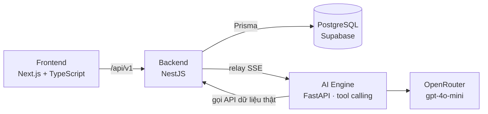

# VinStay AI: tổng quan dự án và kỹ thuật

> Team P-010, VinUni AI20K Build Phase (Cohort 4).

## 1. Dự án về gì

**VinStay AI** là nền tảng cho thuê và vận hành căn hộ tại **Vinhomes Ocean Park** (Gia Lâm, Hà Nội), thí điểm ở The Sapphire 1 & 2. Nền tảng phục vụ 4 vai: **Khách thuê, Chủ nhà, Field Host** (nhân sự nội khu có thẻ thang máy cư dân) và **Admin**.

Nguyên tắc chia việc: **phần mềm** lo tính toán, lọc căn, điều phối và khoá căn; **Field Host** lo việc tại chỗ như đón khách ở sảnh và dẫn lên căn. VinStay không nhận sửa chữa, chỉ giới thiệu thợ ngoài (mô hình asset-light).

### 1.1. Pain point chính: trước và trong lúc thuê

| Pain point | Giải pháp trong sản phẩm |
|---|---|
| **Chủ nhà để trống căn 15–30 ngày, phải đi 20–30 km để mở cửa** | Chủ nhà ký gửi độc quyền. Field Host dẫn khách xem. Mã cửa (PIN mã hoá AES-256) chỉ được cấp qua app khi Host đã đứng tại cửa. Chủ nhà theo dõi từ xa |
| **Khách gặp tin ảo và chi phí ẩn** (phí quản lý, gửi xe, điện nước) | Căn được thẩm định trước khi niêm yết. Bảng **All-in Cost** gộp đủ các khoản phí. Nhãn **"Căn hời"** khi rẻ hơn ≥ 10%. Chatbot AI tư vấn căn theo ngân sách |
| **Khách bỏ hẹn, Sale tranh khách** | Bắt buộc xác thực SĐT trước khi đặt lịch. Ticket điều phối 3 tầng: giao Sale cùng phân khu (3 phút) → cả phân khu → toàn bộ Sale |
| **Lừa cọc, tranh giành căn** | Cọc giữ chỗ 2.000.000đ qua VietQR. Ai trả trước thì được khoá căn ("First-to-Pay Wins"). Khi ký hợp đồng, khoản này chuyển 100% thành tiền cọc bảo đảm, không trừ vào tiền thuê |

### 1.2. Pain point phụ: sau khi thuê, trong thời gian khách ở

| Pain point | Hiện trạng |
|---|---|
| **Tranh chấp hư hao khi trả phòng** | ✅ **Hộ chiếu bàn giao số**: ảnh hiện trạng các hạng mục nội thất được băm SHA-256 làm bằng chứng đối soát (module `handover`) |
| **Nợ điện, nước, phí xe khi khách chuyển đi** | ✅ Chốt chỉ số công tơ lúc nhận và trả phòng (bảng `UtilityReading`) |
| **Hợp đồng sơ sài** | ✅ Hợp đồng thuê PDF sinh từ mẫu pháp lý, niêm phong SHA-256 |
| **Hỏng hóc vặt lúc nửa đêm** | ✅ Chính sách: Host giới thiệu thợ ngoài, khách và thợ tự thoả thuận. Chatbot trả lời quy định này |
| **Khách / Sale gửi ticket sự cố trong thời gian ở** | 🔜 Hướng phát triển: chưa có module ticket sự cố riêng. Hiện ticket chỉ dùng để điều phối ca xem phòng |
| **Vi phạm nội quy BQL bị phạt** | 🔜 Đã số hoá 6 nội quy BQL trong điều khoản cọc. Tự động trừ tiền phạt vào cọc thì chưa có |

## 2. Kỹ thuật sử dụng

| Mảng | Công nghệ | Dùng để làm gì |
|---|---|---|
| **Backend** | **NestJS 10** (TypeScript), Prisma 5 | 17 module nghiệp vụ (đặt lịch, cọc, điều phối, mã cửa, hợp đồng, ký gửi, admin…). Tự quản lý đăng nhập: JWT trong cookie httpOnly, mật khẩu băm scrypt, đăng nhập Google qua Passport. Swagger ở `/api/docs` |
| **Frontend** | **TypeScript**, **Next.js 16 + React 19**, **HTML/CSS** với Tailwind CSS và shadcn UI | Giao diện 4 cổng. `proxy.ts` chặn trang theo phiên đăng nhập và chuyển `/api/v1/*` sang backend. Bản prototype đầu tiên viết bằng HTML/Tailwind/JS thuần (`docs/prototyte.html`) |
| **AI** | **Tool calling** với LLM (`openai/gpt-4o-mini` qua OpenRouter), FastAPI, stream SSE | Chatbot tư vấn thuê căn. LLM không tự trả lời từ trí nhớ mà gọi 5 tool lấy dữ liệu thật: `search_units`, `get_unit`, `compare_units`, `busy_slots`, `lookup_policy`. Câu trả lời đi qua **bộ lọc chính sách** chặn nội dung sai luật (ví dụ "trừ cọc vào tiền thuê", "dùng lockbox"). AI Engine lỗi thì web quay về bộ lọc regex |
| **Database** | **PostgreSQL** trên Supabase (Supabase Storage lưu ảnh và PDF) | 28 bảng do Prisma quản lý. Khoá căn chống tranh chấp bằng transaction: `UPDATE units SET status='HOLDING' WHERE status='AVAILABLE'`, chỉ người trả trước đổi được trạng thái. SĐT và mã cửa mã hoá AES-256-GCM. PL/pgSQL (hàm và trigger) chỉ có trong schema cũ `database/schema.sql`; bản hiện tại đưa logic vào backend |
